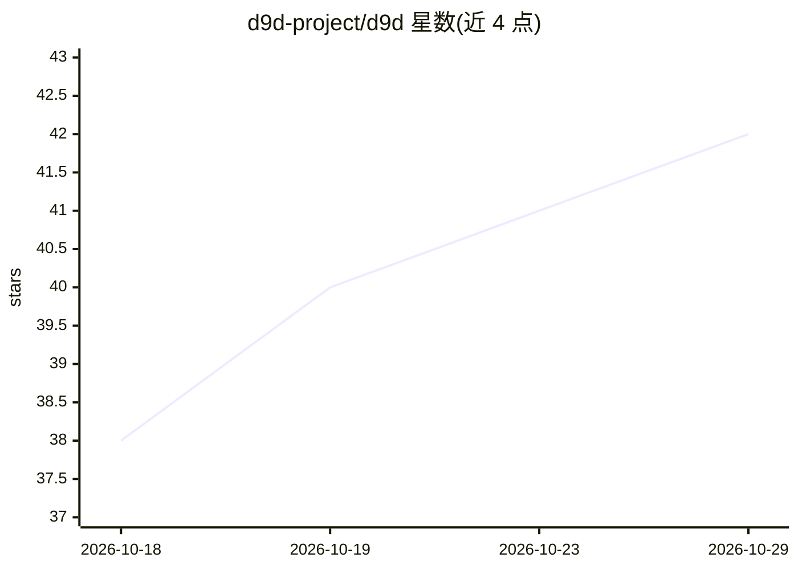

# d9d-project/d9d

⭐ 42 · Python · Apache-2.0 · 推送 2026-10-28 · [GitHub](https://github.com/d9d-project/d9d) · [官网](https://d9d-project.github.io/d9d/) · 组织维护

**可组合的 PyTorch 分布式训练框架，单卡到多机集群**

面向研究者和工程师的分布式训练框架：模型、数据、损失均为用户自己的纯 PyTorch 代码，通过实现 DataProvider、TrainTask、ModelProvider 等接口组合训练任务，框架负责梯度同步、checkpoint、日志等训练循环。支持数据、全分片、张量、上下文、专家与流水线并行在单一 N 维设备网格上组合，可运行 LLM 预训练、微调（含 LoRA）、强化学习、评估与批量推理。以 pip 包安装，无需 fork 仓库；处于 alpha 阶段，公开 API 可能在次要版本间变化。

## 筛选速览

| 维度 | 判定 | 备注 |
|---|---|---|
| AI 角色 | `ai-ecosystem` | LLM/agent 周边工具 |
| 许可风险 | `permissive` | Apache-2.0 |
| 部署形态 | `library` | 以包/库形式分发 |
| 模型依赖 | — | README 未给出锁定关系 |
| 硬件要求 | — | 无带数字的原话,不猜 |
| 安装摩擦 | `low` | 无编译、无系统依赖或容器化 |
| 成熟度 | `idea` | |

## 能力要点

- 数据/全分片/张量/上下文/专家/流水线并行组合于单一 N 维设备网格
- 模型为纯 PyTorch nn.Module，不继承框架类、不读设备网格
- 基于 DTensor、DeviceMesh 与 PyTorch Distributed Checkpoints 等原语实现
- 各组件以接口形式可替换（模型、并行策略、损失、优化器、checkpoint 格式、事件钩子）

## 适用场景

- 在单张消费级 GPU 到多节点集群上运行同一份训练代码
- 加载 Hugging Face checkpoint 做 LLM 微调或 LoRA 训练并导出
- 训练尚无框架支持的新架构（新注意力变体、SSM 等）
- 自定义专家放置或张量并行布局等新并行策略

## 场景标签

`模型训练` `微调` `强化学习` · 领域:训练与推理

## 证据(README 行号)

> L7: **d9d** is a composable framework for distributed training in PyTorch. You do not fit your model into a framework's 
> L9: d9d is for researchers and engineers who change the model, the parallelism or the training method itself. Each chang

## 星数曲线

2026-10-18 38 → 2026-10-29 42（+4）

---
*卡片 v1 · prompt 1.4 · 生成 2026-10-25 · 置信度 high · 依据 README sha `9566e064e7ec` · [字段定义](../../DATASET.md)*
