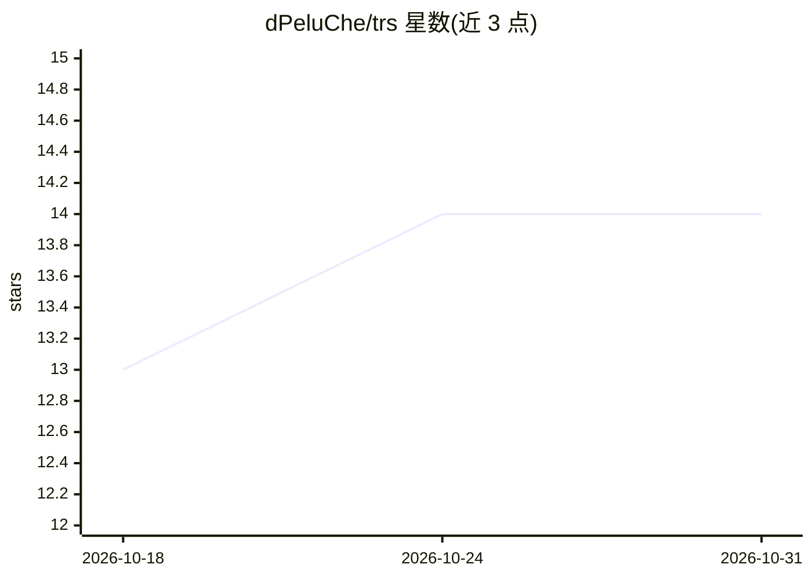

# dPeluChe/trs

⭐ 14 · Rust · MIT · 推送 2026-10-29 · [GitHub](https://github.com/dPeluChe/trs) · [官网](https://usetrs.dev) · 组织维护

**压缩终端输出以降低 AI 编程 agent 的 token 消耗**

用 Rust 编写的原生二进制：在命令前加 `trs` 或通过 `trs init` 把钩子接入 AI 编程工具，解析命令输出并生成面向人类与 LLM 的紧凑版本。为 git、cargo、pytest、docker 等多类命令提供专用解析器，其余命令做空白与 ANSI 清理（节省 2-16%）。端到端支持 16 种 AI agent，另含 output-saver（压缩 agent 回复）、ingest（生成预算感知的仓库摘要）、audit-docs 等配套工具。提供六种输出格式与 JSON/CSV 等结构化选项。

## 筛选速览

| 维度 | 判定 | 备注 |
|---|---|---|
| AI 角色 | `ai-ecosystem` | LLM/agent 周边工具 |
| 许可风险 | `permissive` | MIT |
| 部署形态 | `None` |  |
| 模型依赖 | — | README 未给出锁定关系 |
| 硬件要求 | — | 无带数字的原话,不猜 |
| 安装摩擦 | `low` | 无编译、无系统依赖或容器化 |
| 成熟度 | — | 结构信号不足 |

## 能力要点

- 16 种 AI agent 端到端钩子接入（Claude Code、Cursor、Gemini CLI、Codex CLI 等）
- git/cargo/pytest/docker 等多类命令的专用输出解析器与链式改写
- `trs ingest` 生成预算感知、增量更新的仓库 Markdown 摘要
- `trs output-saver` 向各 agent 全局配置安装压缩回复的规则块

## 适用场景

- 给 AI 编程 agent 的每次工具调用输出做压缩以减少 token 开销
- 把整个代码库生成紧凑摘要喂给 agent 上下文
- 在 CI 或脚本中用 `trs --json` 获取结构化命令输出

## 场景标签

 · 领域:开发者工具/AI agent 基础设施

## 证据(README 行号)

> L24: Prefix any command with `trs` (or let `trs init` wire it into your AI tool for you). The binary spawns your command
> L71: Sixteen agents supported end-to-end. Programmatic hook for Claude Code, Gemini CLI, Cursor, OpenCode, Kilo Code, Pi
> L182: - `trs rewrite`: input compression on every AI-agent tool call.

## 星数曲线

2026-10-18 13 → 2026-10-31 14（+1）

---
*卡片 v1 · prompt 1.4 · 生成 2026-10-31 · 置信度 high · 依据 README sha `d0db0869ba50` · [字段定义](../../DATASET.md)*
