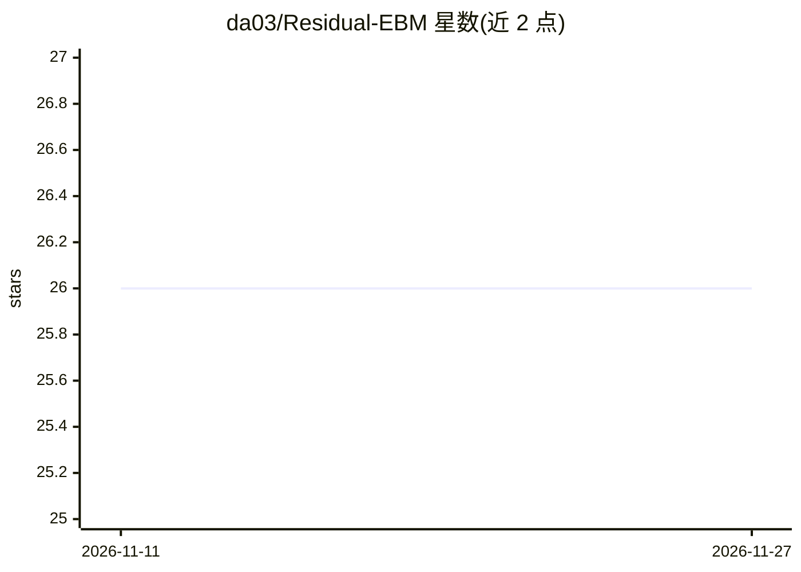

# da03/Residual-EBM

⭐ 26 · Jupyter Notebook · MIT · 推送 2026-11-11 · [GitHub](https://github.com/da03/Residual-EBM) · 个人维护

**PyTorch 复现论文：文本生成的残差能量模型训练评估代码**

论文《Residual Energy-Based Models for Text Generation》（deng2020residual）的官方代码实现，基于 PyTorch。README 说明本仓库的数据与模型（生成器+判别器）与原论文不同，目的是用更少计算资源演示完整流程。训练与评估脚本集中在 REBM.ipynb，建议在 Google Colab 的 GPU 实例上打开运行。另链接一篇讲解序列级能量公式、噪声对比估计与重要性重采样的相关研究文章。

## 筛选速览

| 维度 | 判定 | 备注 |
|---|---|---|
| AI 角色 | `ai-native` | 本体是模型或模型工具 |
| 许可风险 | `permissive` | MIT |
| 部署形态 | `None` |  |
| 模型依赖 | — | README 未给出锁定关系 |
| 硬件要求 | — | 无带数字的原话,不猜 |
| 安装摩擦 | `low` | 无编译、无系统依赖或容器化 |
| 成熟度 | — | 结构信号不足 |

## 能力要点

- 残差能量模型（生成器+判别器）的 PyTorch 实现
- 训练与评估集中在单个 notebook（REBM.ipynb）
- 低计算资源占用的流程演示版本

## 适用场景

- 复现残差能量文本生成方法
- 学习能量模型文本生成的训练流程
- 在 Colab GPU 上快速跑通能量模型实验

## 场景标签

 · 领域:NLP/机器学习研究

## 证据(README 行号)

> L3: This repo implements the Residual Energy-Based Model as described in Residual Energy-Based Models for Text Generatio
> L5: The training and evaluation scripts can be found in REBM.ipynb. We suggest opening it using Google Colab with a GPU 

## 星数曲线

2026-11-11 26 → 2026-11-27 26（+0）

---
*卡片 v1 · prompt 1.4 · 生成 2026-11-18 · 置信度 high · 依据 README sha `6a32aa82fc7c` · [字段定义](../../DATASET.md)*
