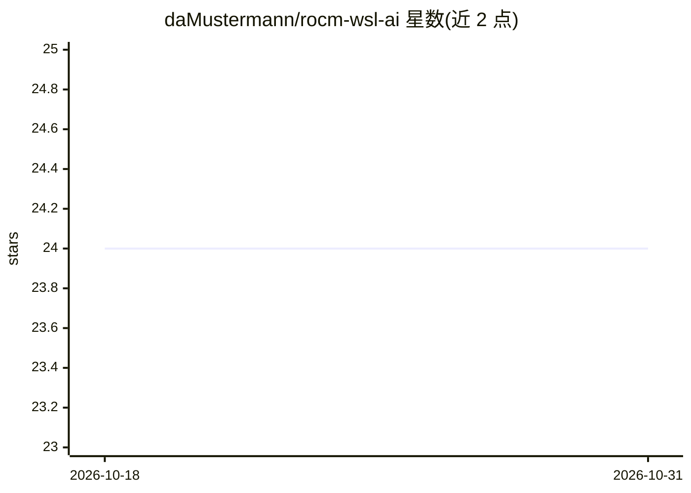

# daMustermann/rocm-wsl-ai

⭐ 24 · Shell · NOASSERTION · 推送 2026-10-11 · [GitHub](https://github.com/daMustermann/rocm-wsl-ai) · 个人维护

**在 WSL2 的 AMD GPU 上安装 ROCm 并统一启动本地 AI 工具**

面向使用 AMD Radeon GPU（RDNA3 及以上）的 Windows 11 用户，提供一键脚本在 WSL2 Ubuntu 中安装 ROCm 10.1 运行环境，并通过交互菜单统一启动 ComfyUI、SD.Next、Automatic1111、kohya_ss、Text Generation WebUI 等工具（各自使用独立 venv 与端口）。核心机制包括：从 AMD 索引在运行时解析版本、实测四种负载的 GPU 自动调优、按序排查并指出原因的 GPU 诊断、空闲休眠释放 VRAM，以及 7.2.x→10.x 的迁移脚本。限制：不支持 RDNA2 及以下，ROCm 10.x WSL 支持处于技术预览阶段。

## 筛选速览

| 维度 | 判定 | 备注 |
|---|---|---|
| AI 角色 | `ai-ecosystem` | LLM/agent 周边工具 |
| 许可风险 | `none` | NOASSERTION |
| 部署形态 | `library` | 以包/库形式分发 |
| 模型依赖 | — | README 未给出锁定关系 |
| 硬件要求 | — | 无带数字的原话,不猜 |
| 安装摩擦 | `medium` | 含编译或系统依赖之一 |
| 成熟度 | `idea` | |

## 能力要点

- 一键脚本安装 ROCm 10.1 并配置 PyTorch 环境（无 Windows SDK、无需编译）
- 统一启动器管理 ComfyUI/SD.Next/A1111/kohya_ss/Text Generation WebUI 等工具
- 基于实测的 GPU 自动调优与性能基准引擎
- GPU 诊断按序检查驱动/DXCore/桥接库/环境变量并给出修复项

## 适用场景

- 在 Windows 11 + AMD 显卡的 WSL2 里搭建本地图像生成与 LLM 环境
- 排查 PyTorch 在 WSL 下识别不到 AMD GPU 的问题
- 对本地 AI 工具做性能调优并按需释放 VRAM

## 场景标签

`图像生成` · 领域:内容生成

## 证据(README 行号)

> L3: **Run Stable Diffusion, ComfyUI and local LLMs on an AMD Radeon GPU under WSL2 — measured, not guessed.**
> L100: `./menu.sh → Performance → Auto-tune` runs four shaped workloads on your actual
> L117: Every supported tool goes through the same path: environment applied *before*

## 星数曲线

2026-10-18 24 → 2026-10-31 24（+0）

---
*卡片 v1 · prompt 1.4 · 生成 2026-10-27 · 置信度 mid · 依据 README sha `be01eaaad990` · [字段定义](../../DATASET.md)*
