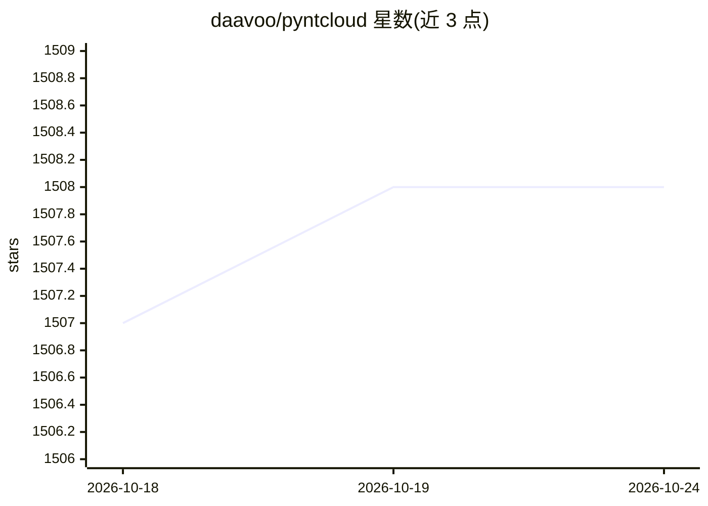

# daavoo/pyntcloud

⭐ 1,508 · Python · MIT · 推送 2026-07-10 · [GitHub](https://github.com/daavoo/pyntcloud) · [官网](http://pyntcloud.readthedocs.io) · 个人维护

**Python 3D 点云处理库：读取、处理、转换点云数据**

基于 Python 科学计算栈的点云处理库，核心类 PyntCloud 提供从文件加载点云（如 PLY）、添加标量场（RGB 转 HSV）、体素化网格构建、按占据体素中心近邻点抽取等操作，并可保存为 NPZ 等格式。通过 from_instance/to_instance 方法支持与 Open3D、PyVista 等 3D 处理库互相转换。以 pip 安装的 Python 库形式提供给开发者使用。

## 筛选速览

| 维度 | 判定 | 备注 |
|---|---|---|
| AI 角色 | `ai-ecosystem` | LLM/agent 周边工具 |
| 许可风险 | `permissive` | MIT |
| 部署形态 | `library` | 以包/库形式分发 |
| 模型依赖 | — | README 未给出锁定关系 |
| 硬件要求 | — | 无带数字的原话,不猜 |
| 安装摩擦 | `low` | 无编译、无系统依赖或容器化 |
| 成熟度 | — | 结构信号不足 |

## 能力要点

- PyntCloud 核心类支持加载/保存点云与标量场运算
- 体素网格构建与近邻点抽取等 3D 处理操作
- 与 Open3D、PyVista 实例互转（from_instance/to_instance）

## 适用场景

- 在 Python 中加载并处理 PLY 等 3D 点云文件
- 将点云与 Open3D/PyVista 生态数据互转
- 对点云做体素化与 RGB→HSV 等标量场转换

## 场景标签

 · 领域:3D 图形/点云处理

## 证据(README 行号)

> L5: **pyntcloud** is a Python library for working with 3D point clouds leveraging the power of the Python scientific sta
> L20: With PyntCloud you can perform complex 3D processing operations with minimum lines of

## 星数曲线

2026-10-18 1,507 → 2026-10-24 1,508（+1）

---
*卡片 v1 · prompt 1.4 · 生成 2026-10-21 · 置信度 mid · 依据 README sha `359deca5cc84` · [字段定义](../../DATASET.md)*
