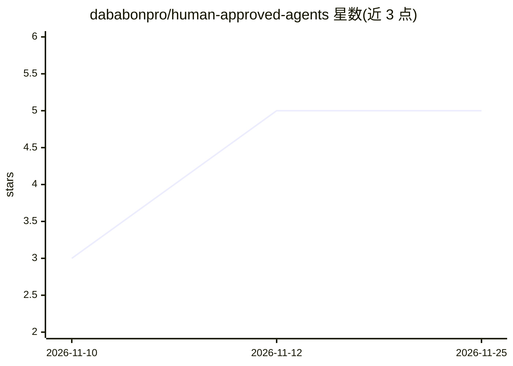

# dababonpro/human-approved-agents

⭐ 5 · Python · MIT · 推送 2026-11-23 · [GitHub](https://github.com/dababonpro/human-approved-agents) · [官网](https://dababon.pro/playbook/) · 组织维护

**给小团队用的 AI agent 治理手册、模板与技能集**

面向 5-50 人、无治理委员会与平台预算的团队，提供如何让 AI agent 在有人类归属和管控的前提下投入使用的指南：包含六份填写模板（agent 规则、清单、风险卡、审批矩阵、事件 runbook、启动检查表）、六个 agent 技能和一份测试 harness。核心机制是三层防线（规则、硬限制、人工检查）与按动作分级的四级权限模型（0 读 / 1 起草 / 2 审批后执行 / 3 限定范围内自主执行）。附带基于 Claude Code 的自动化评估与安慰剂对照测试记录。指南与模板采用 CC BY 4.0，技能与代码采用 MIT。

## 筛选速览

| 维度 | 判定 | 备注 |
|---|---|---|
| AI 角色 | `ai-knowledge` | 知识聚合/清单类 |
| 许可风险 | `permissive` | MIT |
| 部署形态 | `None` |  |
| 模型依赖 | — | README 未给出锁定关系 |
| 硬件要求 | — | 无带数字的原话,不猜 |
| 安装摩擦 | `low` | 无编译、无系统依赖或容器化 |
| 成熟度 | `idea` | |

## 能力要点

- 三层防线机制：规则文件、只读密钥/分支保护等硬限制、人工审批与抽检
- 按动作划分的 0-3 四级权限模型
- 六个 SKILL.md 格式技能（setup-playbook、preview-then-execute 等）
- 包含安慰剂对照的自动化测试记录

## 适用场景

- 为小团队起草 agent 使用规则与审批流程
- 给已有 agent 的项目加一层风险卡和事件 runbook
- 评估 agent 在风险场景下是否遵循书面规则

## 场景标签

 · 领域:AI 治理/团队协作知识

## 证据(README 行号)

> L5: A free playbook, templates and agent skills for small teams putting AI agents to work with clear human ownership and
> L13: |**For**|Teams of 5 to 50 people with no governance committee and no platform budget, whose people already use codi
> L91: playbook/      The guide, a short brief for leaders, how strong the evidence is for each default, and how it maps t

## 星数曲线

2026-11-10 3 → 2026-11-25 5（+2）

---
*卡片 v1 · prompt 1.4 · 生成 2026-11-21 · 置信度 high · 依据 README sha `827e9937a80b` · [字段定义](../../DATASET.md)*
