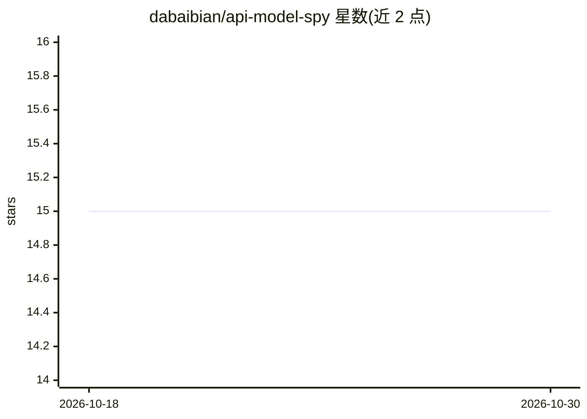

# dabaibian/api-model-spy

⭐ 15 · 推送 2026-05-30 · [GitHub](https://github.com/dabaibian/api-model-spy) · 个人维护 · 中文 README

**检测 LLM API 掺水，指纹识别接口背后实际运行的模型**

面向使用第三方 LLM API 的用户与开发者的检测工具：向 OpenAI 兼容接口或 Anthropic 原生接口发送 10 条诊断探针（身份自述、知识截止日期、分词特征、数值推理、逻辑、响应延迟、reasoning_tokens 等），将响应与 16+ 已知模型特征库对比，判断实际运行的模型，检测到档次低于声称模型时报警，并对不合理低价做价格异常预警。包含 probe.py 发送探针与 analyze.py 生成报告两个脚本，需 Python 3.9+，依赖 openai/anthropic/requests（脚本可自动安装）。README 附带对 xdai.pro 'gpt-5.5' 的实测案例，判定其疑似 o1-mini。

## 筛选速览

| 维度 | 判定 | 备注 |
|---|---|---|
| AI 角色 | `ai-ecosystem` | LLM/agent 周边工具 |
| 许可风险 | `none` | — |
| 部署形态 | `library` | 以包/库形式分发 |
| 模型依赖 | locked-api |  |
| 硬件要求 | — | 无带数字的原话,不猜 |
| 安装摩擦 | `low` | 无编译、无系统依赖或容器化 |
| 成熟度 | — | 结构信号不足 |

## 能力要点

- 10 条诊断探针覆盖身份、推理、分词特征与延迟
- 16+ 模型特征库：GPT-3.5/4/4o/o1、Claude 3/3.5/4、Gemini、Llama、Mistral
- 检测到声称模型与实际档次不符时报警，并做价格异常预警
- 同时支持 OpenAI 兼容接口与 Anthropic 原生接口

## 适用场景

- 购买第三方 API 中转服务前核验背后真实模型
- 排查已用 API 服务是否存在降级/掺水
- 对疑似假名模型（如不存在的版本号）做指纹检测

## 场景标签

`LLM 可观测性` · 领域:评测与运维

## 证据(README 行号)

> L16: `api-model-spy` helps you find out what's really running by sending a battery of diagnostic probes and comparing th
> L20: - 🕵️ **Fingerprint any API** — 10 diagnostic probes covering identity, reasoning, tokenization, and latency
> L24: - 🔌 **Dual API support** — OpenAI-compatible endpoints and Anthropic API

## 星数曲线

2026-10-18 15 → 2026-10-30 15（+0）

---
*卡片 v1 · prompt 1.4 · 生成 2026-10-30 · 置信度 mid · 依据 README sha `b1cfe5194a28` · [字段定义](../../DATASET.md)*
