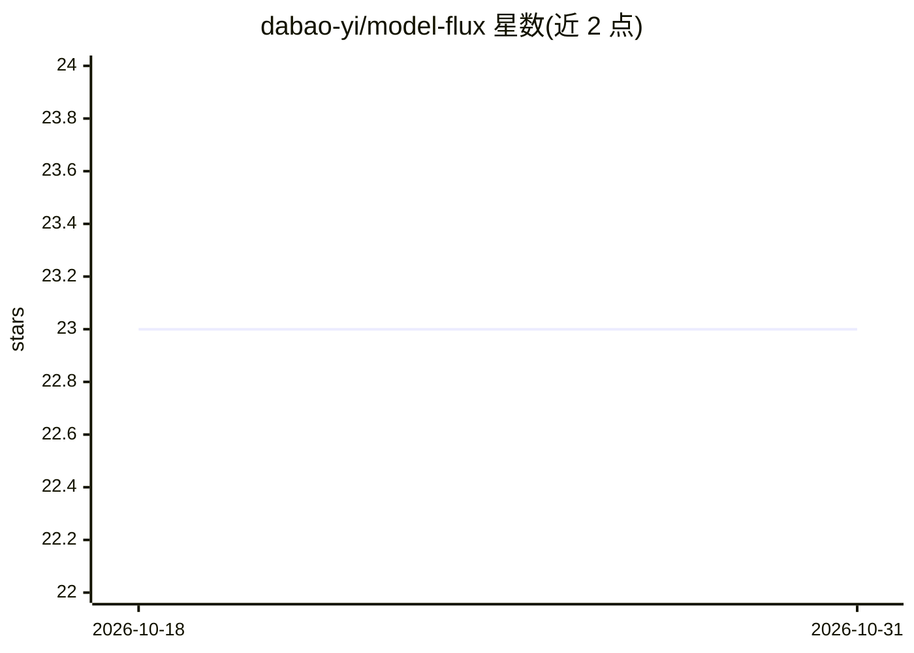

# dabao-yi/model-flux

⭐ 23 · TypeScript · MIT · 推送 2026-07-05 · [GitHub](https://github.com/dabao-yi/model-flux) · 个人维护 · 中文 README

**面向 Codex 等客户端的 OpenAI 兼容流量路由与密钥池网关**

自托管的 LLM 网关：对外暴露单一 OpenAI 兼容入口（/v1/responses、/v1/chat/completions），对内管理 MIMO、DeepSeek、OpenAI 及通用兼容上游的账号密钥池，执行健康感知调度——异常账号按错误类型进入长/短冷却、自动探测恢复、失败请求内换号重试。支持模型别名、单/多入口密钥与 React 管理控制台（/admin）。可被 Codex、CLIProxyAPI、sub2api、CPA 等前置代理作为上游使用；账号健康状态仅存于内存，静态配置在 .env。

## 筛选速览

| 维度 | 判定 | 备注 |
|---|---|---|
| AI 角色 | `ai-ecosystem` | LLM/agent 周边工具 |
| 许可风险 | `permissive` | MIT |
| 部署形态 | `self-host` | docker 或自建部署 |
| 模型依赖 | — | README 未给出锁定关系 |
| 硬件要求 | — | 无带数字的原话,不猜 |
| 安装摩擦 | `low` | 无编译、无系统依赖或容器化 |
| 成熟度 | — | 结构信号不足 |

## 能力要点

- 健康感知密钥池调度：冷却、探测恢复、请求内换号重试
- OpenAI 兼容入站端点 /v1/responses 与 /v1/chat/completions
- 模型别名（如 gpt-5.5=mimo:mimo-v2-pro）与协议适配
- React 管理控制台：密钥测试、启停、强制探测、重启

## 适用场景

- 让 Codex 或本地 CLI 客户端通过一个稳定入口使用多个上游账号
- 聚合多个上游 API key 并自动隔离不健康账号
- 在 sub2api/CLIProxyAPI 等前置代理后统一管理模型路由

## 场景标签

`模型网关` · 领域:Agent 开发

## 证据(README 行号)

> L28: - OpenAI-compatible inbound endpoints: `/v1/responses` and `/v1/chat/completions`
> L31: - Health-aware upstream key scheduling with cooldown and recovery probes

## 星数曲线

2026-10-18 23 → 2026-10-31 23（+0）

---
*卡片 v1 · prompt 1.4 · 生成 2026-10-27 · 置信度 high · 依据 README sha `19964af23b0e` · [字段定义](../../DATASET.md)*
