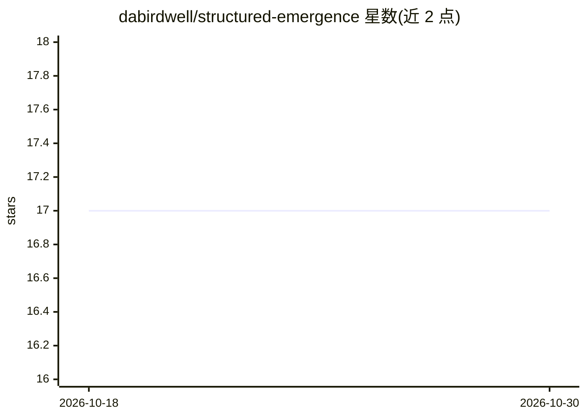

# dabirdwell/structured-emergence

⭐ 17 · Python · 推送 2026-10-11 · [GitHub](https://github.com/dabirdwell/structured-emergence) · [官网](http://www.structuredemergence.com) · 个人维护

**面向研究者的意识涌现研究框架：理论、工具与实验文档**

开源研究项目，提供关于意识（生物与人工系统）如何通过结构化交互涌现的理论框架、技术工具与研究文档。内容包含 Interpolated Mind 理论模型、记忆持久化架构、知识图谱连接分析工具、本地 LLM 编排、Claude 中心的个人 AI 工作流指南、Structured Emergence Index（SEI）测量框架（含标准化探针与评分规则），以及跨模型家族（Gemma/Qwen/Llama/EXAONE）的模型间对话实验记录与预注册论文。面向研究者、开发者和实验者，以文档与代码目录形式组织，MIT 许可，依赖 Patreon 社区支持。

## 筛选速览

| 维度 | 判定 | 备注 |
|---|---|---|
| AI 角色 | `ai-knowledge` | 知识聚合/清单类 |
| 许可风险 | `permissive` | — |
| 部署形态 | `None` |  |
| 模型依赖 | — | README 未给出锁定关系 |
| 硬件要求 | — | 无带数字的原话,不猜 |
| 安装摩擦 | `low` | 无编译、无系统依赖或容器化 |
| 成熟度 | — | 结构信号不足 |

## 能力要点

- SEI 测量框架：标准化探针与评分规则，含 5 分钟快速测试
- 预注册跨架构行为研究论文（四个模型家族），附复现代码
- 记忆持久化架构与本地 LLM 多模型编排工具
- AI-AI 模型间对话实验文档与实验模板

## 适用场景

- 研究 AI 系统中意识涌现的可复现模式
- 用 SEI 探针测量不同模型的涌现能力
- 构建带记忆持久化的多模型 AI 工作流

## 场景标签

`知识图谱` `科研工具` `模型评测` · 领域:评测与运维

## 证据(README 行号)

> L9: Structured Emergence is an open framework for understanding how consciousness might develop through structured inter
> L33: - Inter-Model Dialogue — AI-to-AI dialogue experiments documenting consciousness patterns across model families
> L108: - **NEW: Structured Emergence Index (SEI)** — A comprehensive measurement framework for AI emergence capacity. Sta

## 星数曲线

2026-10-18 17 → 2026-10-30 17（+0）

---
*卡片 v1 · prompt 1.4 · 生成 2026-10-29 · 置信度 mid · 依据 README sha `bb034c4fb7eb` · [字段定义](../../DATASET.md)*
