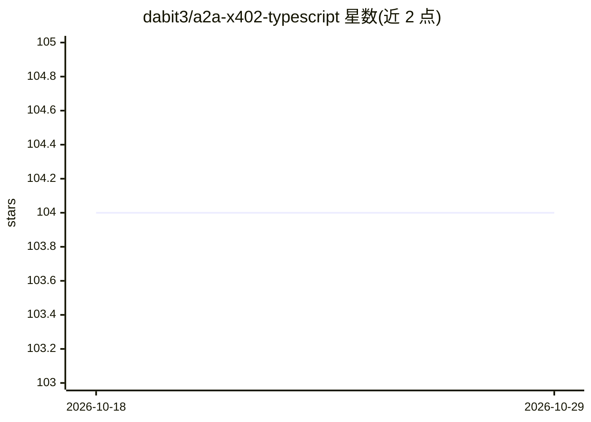

# dabit3/a2a-x402-typescript

⭐ 104 · TypeScript · 推送 2026-07-07 · [GitHub](https://github.com/dabit3/a2a-x402-typescript) · 个人维护

**给 AI agent 开发者：TypeScript 版 x402 加密支付协议库**

Python x402 支付协议扩展的 TypeScript 完整实现，用于 A2A（Agent-to-Agent）通信中的加密货币支付。提供异常式支付请求流程、基于 ethers.js 的以太坊钱包签名与验证、交易结算与支付状态管理，支持 EVM 链（Base/Base Sepolia 等）与 ERC-20 代币（如 USDC）。附带客户端与商户两个示例 agent 及抽象执行器基类，可端到端演示购买支付流程。面向构建支付能力的 AI agent 开发者。

## 筛选速览

| 维度 | 判定 | 备注 |
|---|---|---|
| AI 角色 | `ai-ecosystem` | LLM/agent 周边工具 |
| 许可风险 | `none` | — |
| 部署形态 | `library` | 以包/库形式分发 |
| 模型依赖 | — | README 未给出锁定关系 |
| 硬件要求 | — | 无带数字的原话,不猜 |
| 安装摩擦 | `low` | 无编译、无系统依赖或容器化 |
| 成熟度 | — | 结构信号不足 |

## 能力要点

- 异常式支付请求流程（x402PaymentRequiredException）
- 基于 ethers.js 的钱包签名、验证与结算
- 支持 EVM 多链与 ERC-20 代币（USDC 等）
- 附客户端/商户示例 agent 与抽象执行器基类

## 适用场景

- 为我的 AI agent 添加请求和收取 USDC 支付的能力
- 构建可自动完成代币审批与支付的客户端 agent
- 端到端演示两个 agent 之间的加密货币购买流程

## 场景标签

 · 领域:AI agent 支付基础设施/区块链

## 证据(README 行号)

> L3: A complete TypeScript implementation of the Python x402 payment protocol extension for A2A (Agent-to-Agent) communic
> L46: The library provides a complete implementation of the x402 payment protocol:

## 星数曲线

2026-10-18 104 → 2026-10-29 104（+0）

---
*卡片 v1 · prompt 1.4 · 生成 2026-10-23 · 置信度 high · 依据 README sha `5f49802206ec` · [字段定义](../../DATASET.md)*
