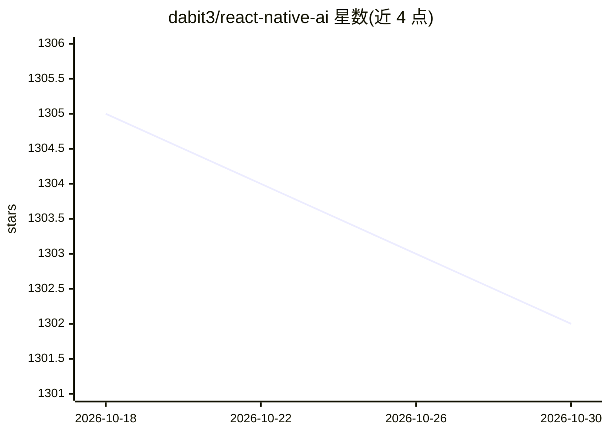

# dabit3/react-native-ai

⭐ 1,302 · TypeScript · MIT · 推送 2026-09-05 · [GitHub](https://github.com/dabit3/react-native-ai) · [官网](https://nader.codes) · 个人维护

**构建跨平台移动 AI 应用的全栈框架，面向开发者**

基于 React Native 与 Express 的全栈框架，用于搭建支持 LLM 实时/流式文本与聊天 UI、图像生成与图像处理的跨平台移动应用。内置 OpenAI、Anthropic Claude、Gemini、Z.ai GLM、Moonshot Kimi 等多家模型接入，提供服务器代理以接入认证授权，自带 5 套主题。通过 npx 脚手架生成项目，分别启动 app 与 server；新增模型需修改 constants.ts 并在 app 与 server 两侧添加对应处理代码，Gemini 图像生成需配置 API key。

## 筛选速览

| 维度 | 判定 | 备注 |
|---|---|---|
| AI 角色 | `ai-ecosystem` | LLM/agent 周边工具 |
| 许可风险 | `permissive` | MIT |
| 部署形态 | `library` | 以包/库形式分发 |
| 模型依赖 | locked-api |  |
| 硬件要求 | — | 无带数字的原话,不猜 |
| 安装摩擦 | `low` | 无编译、无系统依赖或容器化 |
| 成熟度 | — | 结构信号不足 |

## 能力要点

- 多模型 LLM 接入（OpenAI/Claude/Gemini/GLM/Kimi）与实时流式响应
- Gemini 图像生成服务与自然语言生成图像
- 服务器代理支持接入自选认证授权方案
- 内置 5 套主题，可少量代码扩展

## 适用场景

- 快速搭建带多模型聊天界面的移动应用
- 构建支持流式输出与图像生成的跨平台 AI 应用原型
- 通过服务器代理统一管理模型调用与鉴权

## 场景标签

`聊天机器人` `图像生成` `图像视频处理` · 领域:对话与助手

## 证据(README 行号)

> L5: Full stack framework for building cross-platform mobile AI apps supporting LLM real-time / streaming text and chat U
> L13: - LLM support for OpenAI GPT-5.2 + GPT-5 mini, Anthropic Claude Fable 5, Sonnet 5, and Opus/Sonnet/Haiku 4.5, Gemin

## 星数曲线

2026-10-18 1,305 → 2026-10-30 1,302（-3）

---
*卡片 v1 · prompt 1.4 · 生成 2026-10-21 · 置信度 high · 依据 README sha `ad898747af28` · [字段定义](../../DATASET.md)*
