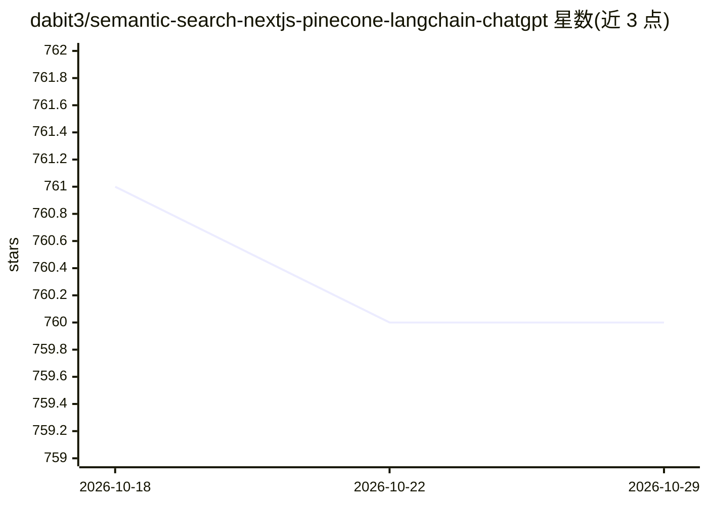

# dabit3/semantic-search-nextjs-pinecone-langchain-chatgpt

⭐ 760 · TypeScript · 推送 2026-02-26 · [GitHub](https://github.com/dabit3/semantic-search-nextjs-pinecone-langchain-chatgpt) · 个人维护

**Next.js 语义搜索入门模板：文本向量化入 Pinecone 后可查询**

基于 Next.js 的全栈入门项目：读取文本文件，经 OpenAI 生成嵌入向量并存入 Pinecone 向量数据库，在 Web 界面中提供语义搜索。预置数据为 Lens 协议开发文档，用户可将自有文本或 Markdown 文件放入 /documents 目录替换。运行需自备 OpenAI API key 与 Pinecone API key；创建索引需 2-4 分钟，代码内置 180 秒等待逻辑，初始化超时则需在 Pinecone 控制台确认状态后重试。

## 筛选速览

| 维度 | 判定 | 备注 |
|---|---|---|
| AI 角色 | `ai-ecosystem` | LLM/agent 周边工具 |
| 许可风险 | `none` | — |
| 部署形态 | `None` |  |
| 模型依赖 | — | README 未给出锁定关系 |
| 硬件要求 | — | 无带数字的原话,不猜 |
| 安装摩擦 | `low` | 无编译、无系统依赖或容器化 |
| 成熟度 | — | 结构信号不足 |

## 能力要点

- 文本文件→嵌入向量→Pinecone 存储→语义搜索的完整流程
- Next.js + LangchainJS + Pinecone + GPT3 技术栈组合
- 支持替换 /documents 目录下的自定义文本或 Markdown 数据

## 适用场景

- 以此为起点搭建自己的语义搜索应用
- 学习 Next.js 与向量数据库、LLM 的集成方式
- 对自己的文档（如 GitHub 仓库转文本）做语义问答检索

## 场景标签

`语义搜索` · 领域:知识与检索

## 证据(README 行号)

> L3: This is a basic starter project for building with the following tools and APIs:
> L14: We are building an app that takes text (text files), embeds them into vectors, stores them into Pinecone, and allow

## 星数曲线

2026-10-18 761 → 2026-10-29 760（-1）

---
*卡片 v1 · prompt 1.4 · 生成 2026-10-21 · 置信度 high · 依据 README sha `05eb054dcd07` · [字段定义](../../DATASET.md)*
