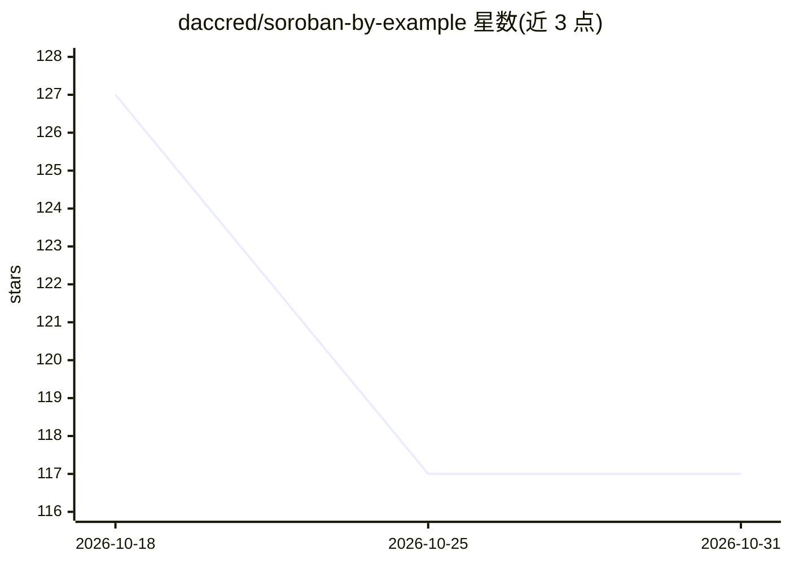

# daccred/soroban-by-example

⭐ 117 · Rust · MIT · 推送 2026-08-28 · [GitHub](https://github.com/daccred/soroban-by-example) · [官网](https://sorobanexamples.xyz) · 组织维护

**Soroban 智能合约入门模板集，含 AI 助手生成合约模板**

面向 Stellar 区块链 Soroban 平台的开发者入门资源：提供精选、可组合、可调整的 Soroban 起步模板包，用于加速智能合约编写；其中包含名为 Soroboy 的 AI 助手（V1），基于真实世界用例生成智能合约模板。README 内容较少，具体安装方式、模板数量与 AI 助手接入细节未在可见范围内说明。

## 筛选速览

| 维度 | 判定 | 备注 |
|---|---|---|
| AI 角色 | `ai-native` | 本体是模型或模型工具 |
| 许可风险 | `permissive` | MIT |
| 部署形态 | `None` |  |
| 模型依赖 | — | README 未给出锁定关系 |
| 硬件要求 | — | 无带数字的原话,不猜 |
| 安装摩擦 | `low` | 无编译、无系统依赖或容器化 |
| 成熟度 | — | 结构信号不足 |

## 能力要点

- Soroban/Stellar 智能合约起步模板包
- AI 助手 Soroboy（V1）按真实用例生成合约模板
- 模板定位为可组合、可调整

## 适用场景

- 初学 Soroban 智能合约开发时获取起步模板
- 按业务用例让 AI 助手生成合约模板骨架

## 场景标签

`代码生成` · 领域:编码与开发

## 证据(README 行号)

> L3: A carefully curated, lightweight, composable, and tweakable Soroban starter pack to get you writing for the Stellar 
> L10: - Soroboy ✨ (V1)

## 星数曲线

2026-10-18 127 → 2026-10-31 117（-10）

---
*卡片 v1 · prompt 1.4 · 生成 2026-10-23 · 置信度 low · 依据 README sha `bcf5eef4b356` · [字段定义](../../DATASET.md)*
