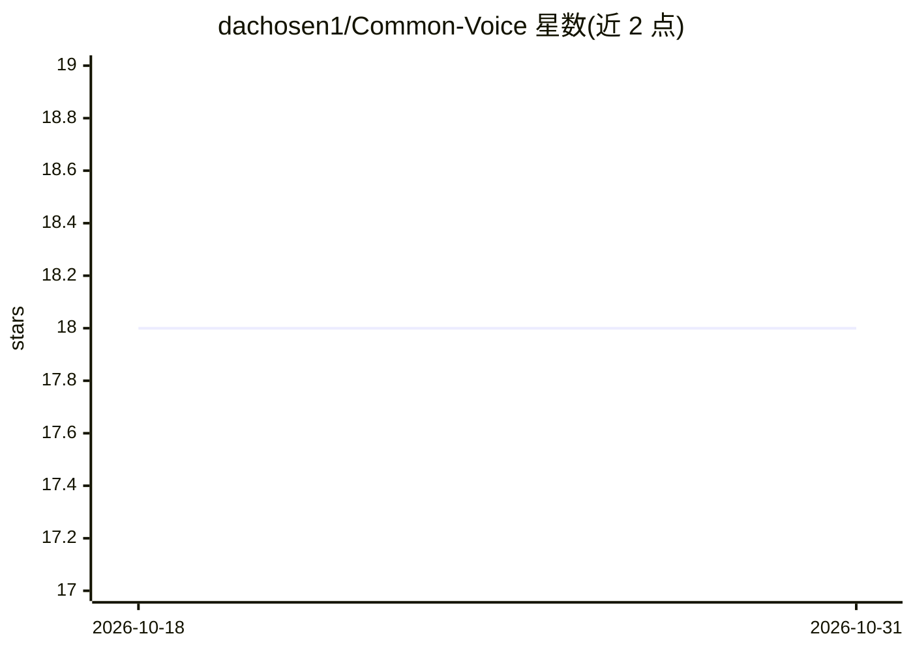

# dachosen1/Common-Voice

⭐ 18 · Python · MIT · 推送 2026-06-08 · [GitHub](https://github.com/dachosen1/Common-Voice) · 个人维护

**实时音频流分类应用：预测说话人性别、年龄、国别**

基于 Mozilla Common Voice 数据集的端到端机器学习应用：实时录音并以约 1 秒延迟通过 socket API 输出流式预测，预测类别为性别、年龄与原属国家；年龄与国别模型在 Todo 中标注尚未实现。提供模型训练流程（修改数据目录后运行 run_pipeline.py）与部署流程：Windows 用 pip 安装依赖运行 run_app.py，Linux 通过 Docker Compose、Nginx、Certbot 与 snd-aloop 音频模块部署。面向音频/机器学习开发者。

## 筛选速览

| 维度 | 判定 | 备注 |
|---|---|---|
| AI 角色 | `ai-native` | 本体是模型或模型工具 |
| 许可风险 | `permissive` | MIT |
| 部署形态 | `self-host` | docker 或自建部署 |
| 模型依赖 | — | README 未给出锁定关系 |
| 硬件要求 | — | 无带数字的原话,不猜 |
| 安装摩擦 | `low` | 无编译、无系统依赖或容器化 |
| 成熟度 | `idea` | |

## 能力要点

- 实时录音音频流式预测（约 1 秒延迟，socket API 输出）
- 预测三个类别：性别、年龄、原属国家
- 提供训练管线 run_pipeline.py 与 Linux Docker/Nginx 部署步骤

## 适用场景

- 对麦克风音频流做说话人属性分类
- 学习基于 Common Voice 数据集的端到端音频分类流水线
- 在 Linux 服务器上部署流式音频预测服务

## 场景标签

`模型训练` · 领域:训练与推理

## 证据(README 行号)

> L12: The goal for this project is to create an end to end machine learning appliacation that records and processes audio
> L16: The application generates prediction in 3 categories: Gender, Age and Country of Origin.

## 星数曲线

2026-10-18 18 → 2026-10-31 18（+0）

---
*卡片 v1 · prompt 1.4 · 生成 2026-10-29 · 置信度 high · 依据 README sha `3d41d5fec0fa` · [字段定义](../../DATASET.md)*
