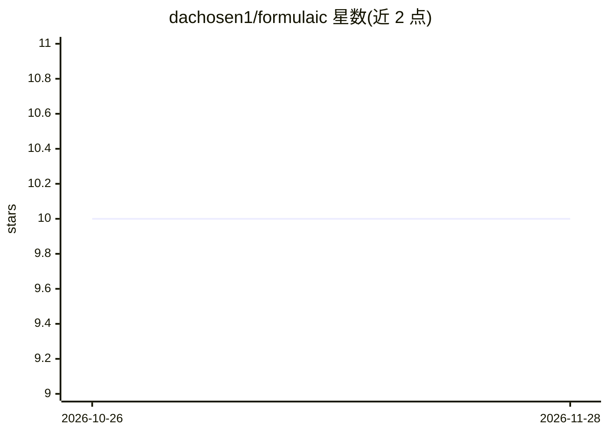

# dachosen1/formulaic

⭐ 10 · R · GPL-3.0 · 推送 2026-05-31 · [GitHub](https://github.com/dachosen1/formulaic) · [官网](https://dachosen1.github.io/formulaic/) · 个人维护

**R 用户动态生成公式对象并做质量检查的 R 包**

formulaic 是一个发布于 CRAN 的 R 包，用于以编程方式动态生成统计模型的公式对象。核心函数 create.formula 从输入变量列表和结果变量自动构建公式，并执行系列资格测试（拼写错误、重复、缺乏对比、类别水平过多等）；reduce.existing.formula 对既有公式做同样修剪；add.backticks 为需要反引号的变量加反引号。输出包含 inclusion table 以记录变量取舍依据。生成的公式可用于线性回归及各类依赖公式对象的 R 模型。

## 筛选速览

| 维度 | 判定 | 备注 |
|---|---|---|
| AI 角色 | `ai-ecosystem` | LLM/agent 周边工具 |
| 许可风险 | `viral` | GPL-3.0 |
| 部署形态 | `None` |  |
| 模型依赖 | — | README 未给出锁定关系 |
| 硬件要求 | — | 无带数字的原话,不猜 |
| 安装摩擦 | `low` | 无编译、无系统依赖或容器化 |
| 成熟度 | — | 结构信号不足 |

## 能力要点

- create.formula 从变量向量与命名模式动态生成公式
- 质量检查覆盖拼写错误、重复、缺乏对比与高基数类别变量
- inclusion table 记录每个变量纳入/排除的原因
- 支持单侧公式（outcome.name = NULL）以适配 xtabs/model.matrix 等函数

## 适用场景

- 建模前自动筛选和清理候选特征变量
- 从应用中的用户输入动态构建模型公式
- 修剪既有公式并透明地报告变量排除原因

## 场景标签

 · 领域:统计计算/数据科学工具

## 证据(README 行号)

> L11: Many statistical models and analyses in R are implemented through formula objects. The formulaic package creates a 
> L28: **create.formula** automatically creates a formula from a provided list of input variables and the output variable.

## 星数曲线

2026-10-26 10 → 2026-11-28 10（+0）

---
*卡片 v1 · prompt 1.4 · 生成 2026-11-19 · 置信度 mid · 依据 README sha `164b4236e2b8` · [字段定义](../../DATASET.md)*
