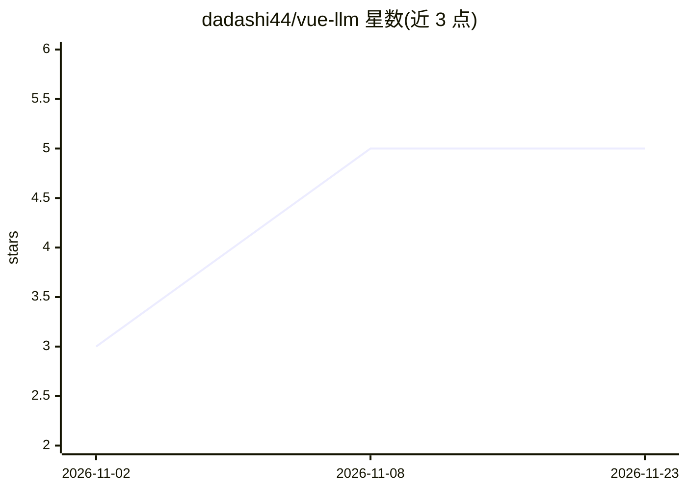

# dadashi44/vue-llm

⭐ 5 · TypeScript · MIT · 推送 2026-11-17 · [GitHub](https://github.com/dadashi44/vue-llm) · [官网](http://vue-llm.js.org/) · 个人维护

**Vue/Nuxt 开发者的 AI SDK：流式聊天与多模型接入**

面向 Vue 3/Nuxt 的 LLM 接入 SDK，提供 useChat 组合式函数（流式、中止、重试）、defineTool 工具调用、Generative UI 渲染、附件上传、localStorage 持久化、客户端与限速中间件。内置 OpenAI、Anthropic、Gemini、Ollama 四个 provider 工厂，并通过 createWebLLM 支持 WebGPU 浏览器端模型运行。提供 npx 安装的聊天 UI 组件、Vue DevTools 面板与 Nuxt 模块（自动导入与运行时配置），零运行时依赖，仅 vue 为 peer dependency。

## 筛选速览

| 维度 | 判定 | 备注 |
|---|---|---|
| AI 角色 | `ai-ecosystem` | LLM/agent 周边工具 |
| 许可风险 | `permissive` | MIT |
| 部署形态 | `library` | 以包/库形式分发 |
| 模型依赖 | local-ok | 支持本地模型 |
| 硬件要求 | — | 无带数字的原话,不猜 |
| 安装摩擦 | `low` | 无编译、无系统依赖或容器化 |
| 成熟度 | — | 结构信号不足 |

## 能力要点

- useChat 组合式函数支持流式、工具调用与多 provider 切换
- createWebLLM 在浏览器 WebGPU 上运行 Llama/Qwen/SmolLM，数据不出设备
- defineTool 与 <MessageParts> 支持工具调用渲染为 Vue 组件
- Nuxt 模块提供自动导入、DevTools 面板与运行时配置

## 适用场景

- 为 Vue 或 Nuxt 应用接入多家 LLM 服务
- 在浏览器端离线运行小型模型构建聊天功能
- 将工具调用结果渲染为自定义 Vue 组件
- 自建带重试与限流的聊天后端代理

## 场景标签

 · 领域:前端开发框架/LLM 接入

## 证据(README 行号)

> L10: **vue-llm** is the AI SDK for Vue and Nuxt: streaming `useChat`, tool calling, Generative UI and in-browser models 
> L12: `useChat()` with streaming, tool calling, multi-provider support — in 10 lines of code.
> L32: - **Nuxt module** — auto-imports, components, DevTools in development, server-side runtime config

## 星数曲线

2026-11-02 3 → 2026-11-23 5（+2）

---
*卡片 v1 · prompt 1.4 · 生成 2026-11-21 · 置信度 high · 依据 README sha `9e1c7eb6ada3` · [字段定义](../../DATASET.md)*
