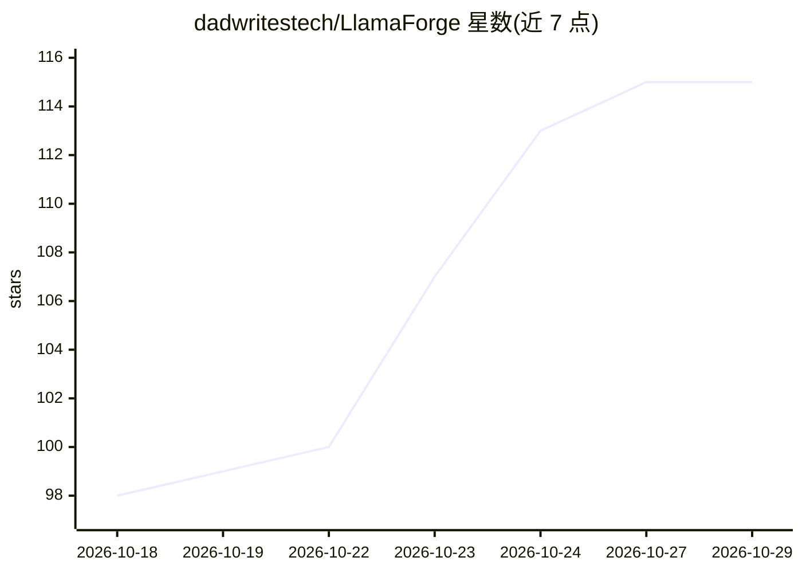

# dadwritestech/LlamaForge

⭐ 115 · Python · MIT · 推送 2026-10-26 · [GitHub](https://github.com/dadwritestech/LlamaForge) · [官网](https://dadwritestech.github.io/LlamaForge/) · 个人维护

**浏览器中驱动官方 llama.cpp 的本地模型控制面板**

面向本地 LLM 用户的 llama.cpp 管理面板：安装并驱动 llama.cpp 官方 llama-server，按 GGUF 元数据在加载前预估 VRAM 占用与适配评级，提供逐模型的全部 llama-server 标志编辑、一键引擎更新与回滚、多模型并行规划、Hugging Face GGUF 搜索下载、OpenAI/Anthropic 兼容 API、MCP server 与本地 agent（Embers，引语经代码核验）。纯 Python 标准库后端，不含 llama.cpp 代码；自述为早期预览，Windows+NVIDIA 测试最多，Linux/macOS 过 CI 但实机使用少。

## 筛选速览

| 维度 | 判定 | 备注 |
|---|---|---|
| AI 角色 | `ai-ecosystem` | LLM/agent 周边工具 |
| 许可风险 | `permissive` | MIT |
| 部署形态 | `library` | 以包/库形式分发 |
| 模型依赖 | local-ok | 支持本地模型 |
| 硬件要求 | `cpu-ok` | |
| 安装摩擦 | `high` | 编译与系统依赖俱全 |
| 成熟度 | `idea` | |

## 能力要点

- 加载前按模型真实尺寸预估 VRAM 并给出 FITS/TIGHT/CPU OFFLOAD 评级
- 暴露 llama-server --help 的全部标志（200+），逐模型可编辑
- 一键安装/更新/回滚官方 llama.cpp 构建，也可用自有构建或 fork
- 提供 OpenAI/Anthropic 兼容 API、MCP server 与本地 agent（Embers）

## 适用场景

- 在浏览器里统一管理本机多个 GGUF 模型的加载与参数
- 下载前判断一个 Hugging Face 量化版本是否装得进自己的显卡
- 让 Claude Code、Cline 等客户端通过本地 OpenAI 兼容 API 使用模型

## 场景标签

`推理引擎` · 领域:训练与推理

## 证据(README 行号)

> L24: LlamaForge runs no models itself. It installs and drives llama.cpp's own `llama-server` router and
> L31: update their bundled engine. LlamaForge runs the **official llama.cpp release itself** (or

## 星数曲线

2026-10-18 98 → 2026-10-29 115（+17）

---
*卡片 v1 · prompt 1.4 · 生成 2026-10-23 · 置信度 mid · 依据 README sha `4291912c15e2` · [字段定义](../../DATASET.md)*
