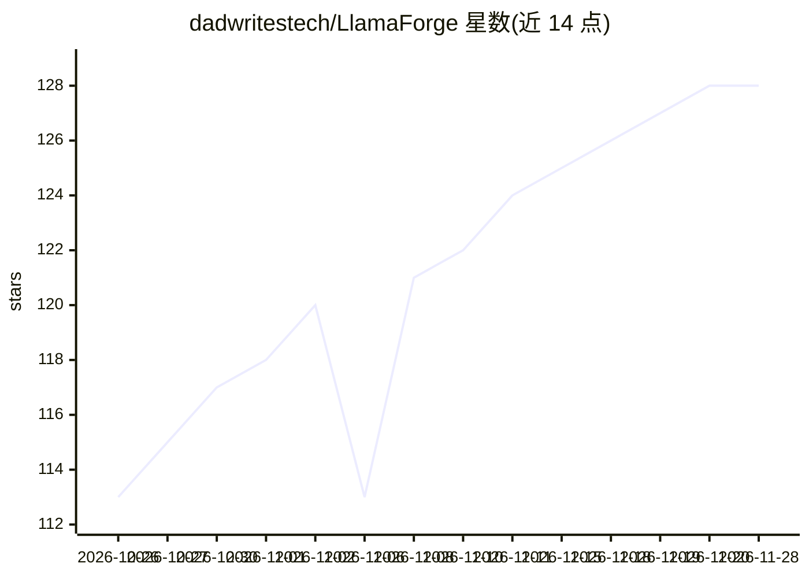

# dadwritestech/LlamaForge

⭐ 128 · Python · MIT · 推送 2026-11-05 · [GitHub](https://github.com/dadwritestech/LlamaForge) · [官网](https://dadwritestech.github.io/LlamaForge/) · 个人维护 · 中文 README

**为本地用户管理 llama.cpp 服务的浏览器控制面板**

以浏览器访问的控制面板驱动官方 llama.cpp 的 llama-server 路由器并代为编辑 models.ini，本身不运行模型。提供模型发现、下载前 VRAM 适配评级、逐模型 llama-server 参数编辑、多模型并行加载、Auto-Forge 实测调参、一键构建/更新 llama.cpp、TTS、Arena 评测与本地 Embers 代理。对 OpenAI/Anthropic 兼容 API，提供 MCP server 与 agent 技能。早期预览阶段，Windows + NVIDIA 是测试最充分的路径。

## 筛选速览

| 维度 | 判定 | 备注 |
|---|---|---|
| AI 角色 | `ai-ecosystem` | LLM/agent 周边工具 |
| 许可风险 | `permissive` | MIT |
| 部署形态 | `library` | 以包/库形式分发 |
| 模型依赖 | local-ok | 支持本地模型 |
| 硬件要求 | — | 无带数字的原话,不猜 |
| 安装摩擦 | `high` | 编译与系统依赖俱全 |
| 成熟度 | `idea` | |

## 能力要点

- 下载前按 GGUF 头对用户 VRAM 给出 FITS/TIGHT/CPU OFFLOAD 适配评级
- Auto-Forge 在用户 GPU 上实测放置、KV cache 与投机草稿组合，可一键应用/撤销
- 复用 Ollama 已下载的模型文件，无需重新下载
- 内置 MCP server 与 npx skills 技能，供编码代理查询/加载模型

## 适用场景

- 在浏览器里管理本机 GGUF 模型的加载、卸载与逐模型参数
- 为 Open WebUI、SillyTavern、Cline 等客户端提供本地 OpenAI 兼容接口
- 买显卡前用 Can I run it 表格估算模型能否跑起来
- 让 Claude Code/Codex 通过 MCP 在本地 GPU 上执行任务

## 场景标签

`推理引擎` `模型网关` `模型评测` · 领域:Agent 开发

## 证据(README 行号)

> L35: LlamaForge runs no models itself. It installs and drives llama.cpp's own `llama-server` router and
> L57: |OpenAI + Anthropic-compatible API|✅, plus one-click Claude Code / Codex / pi.dev config|✅|✅|
> L86: - **Build / Update**: one-click official llama.cpp builds with rollback, or build from source with flags detected f

## 星数曲线

2026-10-26 113 → 2026-11-28 128（+15）

---
*卡片 v1 · prompt 1.4 · 生成 2026-11-28 · 置信度 mid · 依据 README sha `a3808a6b5a1f` · [字段定义](../../DATASET.md)*
