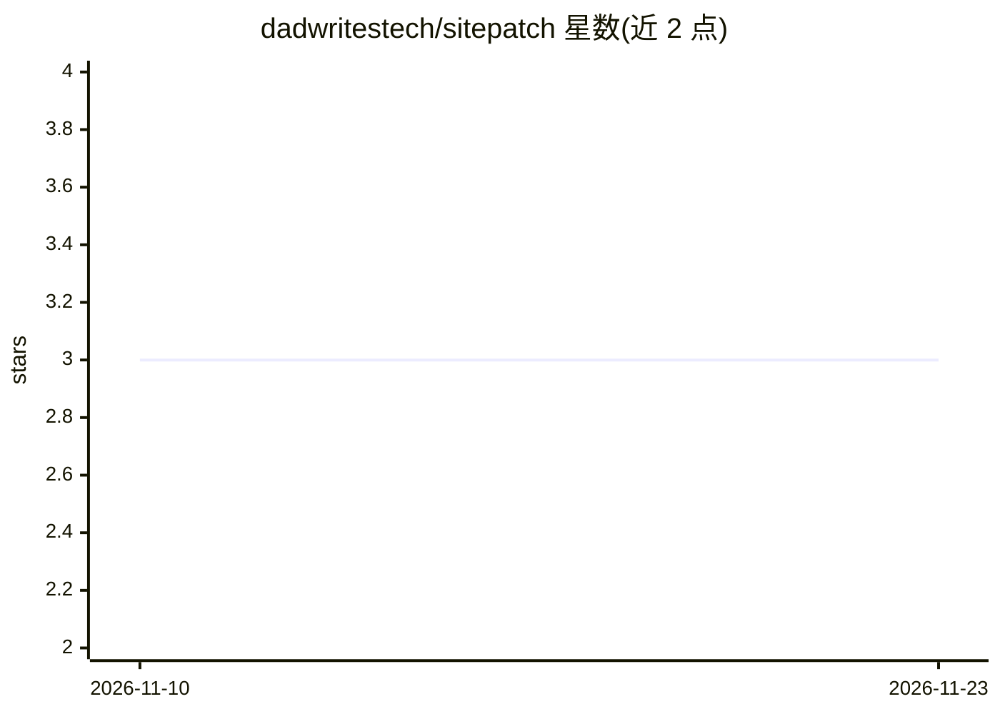

# dadwritestech/sitepatch

⭐ 3 · JavaScript · Apache-2.0 · 推送 2026-11-07 · [GitHub](https://github.com/dadwritestech/sitepatch) · [官网](https://dadwritestech.github.io/sitepatch/site/) · 个人维护

**用自然语言让 LLM 生成并验证网页修改用的 userscript 补丁**

sitepatch 接受一句自然语言请求，由 LLM 输出受约束的补丁 spec（hide/move），编译为 userscript，并在真实登录外 Chromium 中以两次页面加载验证：DOM 断言、before/after 截图与像素级可见效果检查，通过后存入可一键安装的 git 注册表。每日 CI 对所有补丁重测，失效时由 agent 尝试修复。限制包括每补丁单一测试 URL、仅支持 light DOM、拒绝处理付费墙/广告/DRM/验证码等请求。工具采用 Apache-2.0 许可。

## 筛选速览

| 维度 | 判定 | 备注 |
|---|---|---|
| AI 角色 | `ai-native` | 本体是模型或模型工具 |
| 许可风险 | `permissive` | Apache-2.0 |
| 部署形态 | `library` | 以包/库形式分发 |
| 模型依赖 | — | README 未给出锁定关系 |
| 硬件要求 | — | 无带数字的原话,不猜 |
| 安装摩擦 | `low` | 无编译、无系统依赖或容器化 |
| 成熟度 | — | 结构信号不足 |

## 能力要点

- LLM 输出受约束 spec 而非任意 JS，固定运行时编译为 userscript
- 在真实 Chromium 中以派生 DOM 断言与像素级截图检查验证补丁
- 每日 CI 重测所有补丁，失效时将浏览器判定反馈给 agent 修复
- 拒绝涉及付费墙、广告、DRM、验证码、登录的请求

## 适用场景

- 用一句话隐藏网站上不需要的界面元素
- 把页面上的某个区块移到另一位置
- 维护一批随网站改版自动检测并尝试修复的补丁

## 场景标签

`浏览器自动化` · 领域:效率与自动化

## 证据(README 行号)

> L9: An LLM writes a userscript. A real, logged-out Chromium proves the userscript works on the live site with before/aft
> L60: - **The LLM writes a spec, not raw JS.** It outputs `{hide: [css], move: [{selector, before|after}]}`. A fixed runt
> L81: sitepatch only hides and rearranges. Before the LLM is called, it refuses requests about paywalls, ads or sponsored

## 星数曲线

2026-11-10 3 → 2026-11-23 3（+0）

---
*卡片 v1 · prompt 1.4 · 生成 2026-11-22 · 置信度 high · 依据 README sha `1b47f812318a` · [字段定义](../../DATASET.md)*
