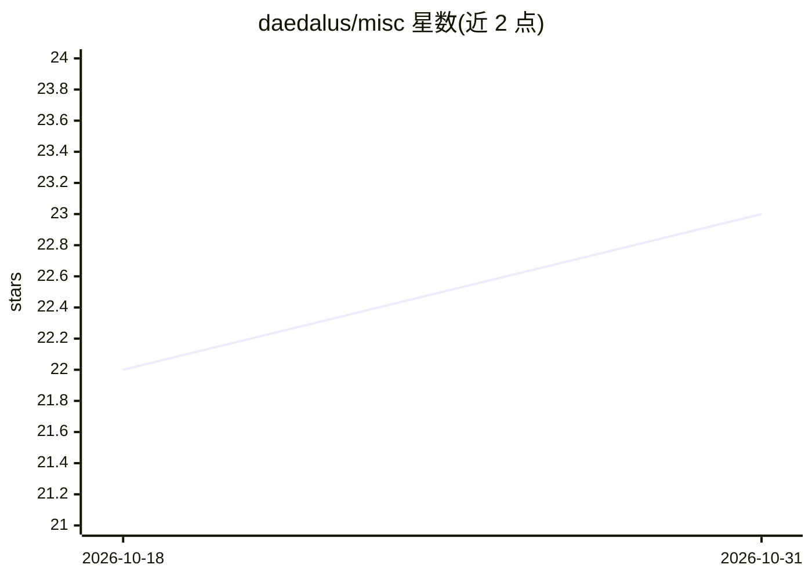

# daedalus/misc

⭐ 23 · Python · 推送 2026-10-20 · [GitHub](https://github.com/daedalus/misc) · 个人维护

**密码学/比特币/安全研究的杂项脚本集合，供授权安全测试与学习**

个人维护的杂项脚本仓库，涵盖密码学、比特币/区块链工具、安全研究（含进攻性技术演示与 CVE PoC）、网络与系统管理、数学及通用工具。通过 Makefile 驱动常用任务（bootstrap/doctor/lint/format），脚本可独立运行，部分需 pip 安装依赖或 Linux 工具（cryptsetup、virsh、nmap）。README 声明仅限授权渗透测试、学术研究与受控实验环境使用，不含任何 AI 相关内容。

## 筛选速览

| 维度 | 判定 | 备注 |
|---|---|---|
| AI 角色 | `ai-enhanced` | 去掉 AI 部分产品仍成立 |
| 许可风险 | `none` | — |
| 部署形态 | `library` | 以包/库形式分发 |
| 模型依赖 | — | README 未给出锁定关系 |
| 硬件要求 | — | 无带数字的原话,不猜 |
| 安装摩擦 | `low` | 无编译、无系统依赖或容器化 |
| 成熟度 | — | 结构信号不足 |

## 能力要点

- Makefile 统一驱动 bootstrap/doctor/lint/format 等任务
- 脚本可独立运行，依赖经 requirements.txt 安装
- 含密码学、比特币工具、安全研究 PoC 与网络侦察脚本
- 明确限定仅限授权测试与研究用途

## 适用场景

- 在授权环境中做渗透测试与安全研究实验
- 学习密码学算法与比特币/区块链工具实现
- 复用系统管理与网络工具脚本

## 场景标签

`网络安全` · 领域:学习与行业

## 证据(README 行号)

> L5: Topics covered include cryptography, Bitcoin/blockchain tooling, security research, networking utilities, system adm

## 星数曲线

2026-10-18 22 → 2026-10-31 23（+1）

---
*卡片 v1 · prompt 1.4 · 生成 2026-10-27 · 置信度 low · 依据 README sha `210756862422` · [字段定义](../../DATASET.md)*
