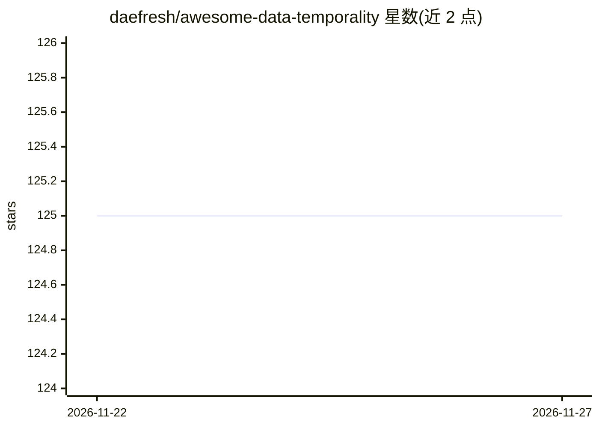

# daefresh/awesome-data-temporality

⭐ 125 · 推送 2026-11-21 · [GitHub](https://github.com/daefresh/awesome-data-temporality) · 个人维护

**时间性数据管理的资源清单：版本化、时态表、CDC 等**

一份按主题组织的策展清单，收录数据时间性相关的工具与文章链接，覆盖六个板块：面向机器学习的数据版本化（DVC、lakeFS、Dolt 等）、时间旅行与时态表（Iceberg、Delta Lake、各数据库时态表）、缓慢变化维度建模、双时态工具与建模（XTDB、Bitempura 等）、变更数据捕获（CDC）工具，以及各 ORM 框架的软删除实践。由个人收藏发展而来，欢迎贡献。

## 筛选速览

| 维度 | 判定 | 备注 |
|---|---|---|
| AI 角色 | `ai-knowledge` | 知识聚合/清单类 |
| 许可风险 | `none` | — |
| 部署形态 | `None` |  |
| 模型依赖 | — | README 未给出锁定关系 |
| 硬件要求 | — | 无带数字的原话,不猜 |
| 安装摩擦 | `low` | 无编译、无系统依赖或容器化 |
| 成熟度 | — | 结构信号不足 |

## 能力要点

- 六个板块组织：ML 数据版本化、时间旅行/时态表、SCD、双时态、CDC、ORM 软删除
- 收录 DVC、lakeFS、Iceberg、Debezium、XTDB 等工具链接
- 每个板块附概念性介绍说明术语含义

## 适用场景

- 为数据项目选择数据版本控制工具
- 了解双时态数据库与建模的资料入口
- 查找数据库变更捕获与软删除的实践参考

## 场景标签

`精选清单` · 领域:学习与行业

## 证据(README 行号)

> L1: # Awesome Data Temporality
> L2: > A curated list to help you manage temporal data across many modalities 🚀.
> L130: This list started as personal collection of interesting things about data versioning. Your contributions and sugge

## 星数曲线

2026-11-22 125 → 2026-11-27 125（+0）

---
*卡片 v1 · prompt 1.4 · 生成 2026-11-22 · 置信度 high · 依据 README sha `1435472d3454` · [字段定义](../../DATASET.md)*
