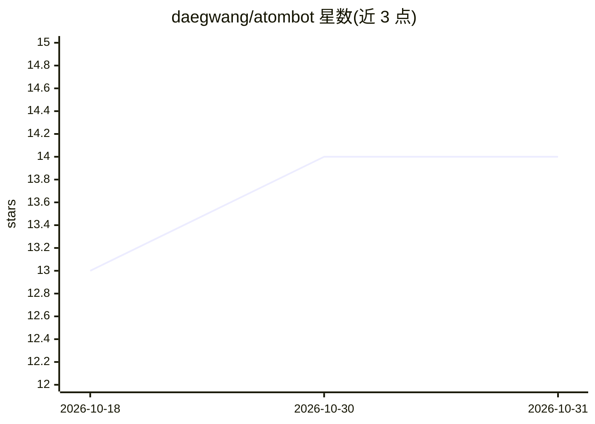

# daegwang/atombot

⭐ 14 · Python · MIT · 推送 2026-03-14 · [GitHub](https://github.com/daegwang/atombot) · 个人维护

**轻量级个人 AI 助手：Telegram/CLI 对话与提醒**

用约 500 行代码实现的个人 AI 助手，支持 OpenAI 兼容端点与 Codex(CLI 模式) 两种 LLM 接入方式。提供 Telegram 网关（基于白名单的访问控制）、可检索的长期记忆日志、一次性与循环提醒、兼容 OpenClaw SKILL.md 格式的技能系统，以及自动检测 Codex / LM Studio / Ollama 的引导式初始化。用户可通过 Telegram 或终端 CLI 与 agent 交互，覆盖对话、网页抓取、编码、日程管理等场景。

## 筛选速览

| 维度 | 判定 | 备注 |
|---|---|---|
| AI 角色 | `ai-native` | 本体是模型或模型工具 |
| 许可风险 | `permissive` | MIT |
| 部署形态 | `library` | 以包/库形式分发 |
| 模型依赖 | local-ok | 支持本地模型 |
| 硬件要求 | — | 无带数字的原话,不猜 |
| 安装摩擦 | `low` | 无编译、无系统依赖或容器化 |
| 成熟度 | — | 结构信号不足 |

## 能力要点

- 核心功能约 500 行代码实现
- Telegram 网关 + 白名单访问控制
- 长期记忆与可检索的每日历史日志
- 兼容 OpenClaw SKILL.md 技能格式

## 适用场景

- 通过 Telegram 或终端与个人 AI 助手对话
- 设置一次性或循环提醒并持久记忆对话历史
- 复用 OpenClaw 格式的技能扩展助手能力

## 场景标签

`AI 助手` `Agent 记忆` · 领域:Agent 开发

## 证据(README 行号)

> L3: # Atombot: Atomic-lightweight personal AI assistant
> L5: 🐙 A tiny but powerful personal AI assistant inspired by OpenClaw and nanobot.

## 星数曲线

2026-10-18 13 → 2026-10-31 14（+1）

---
*卡片 v1 · prompt 1.4 · 生成 2026-10-31 · 置信度 high · 依据 README sha `e1d8f2c4d5b6` · [字段定义](../../DATASET.md)*
