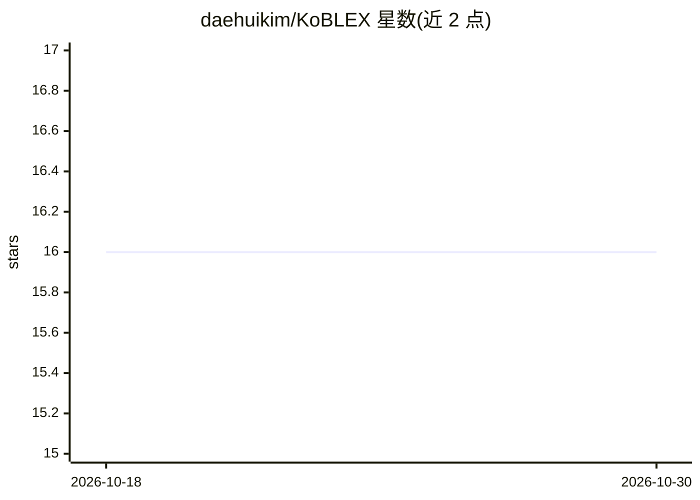

# daehuikim/KoBLEX

⭐ 16 · Python · NOASSERTION · 推送 2025-11-03 · [GitHub](https://github.com/daehuikim/KoBLEX) · 组织维护

**韩国法律多跳推理问答评测基准（226 题，EMNLP 2025）**

EMNLP 2025 论文 KoBLEX 的官方仓库，提供韩国法律可解释开放式问答基准：226 道多跳问题及答案与支持法条，经 LLM 生成加专家修订的混合流程构建；附韩文法条语料与英译文版本（英文仅到条（조）级且无法与韩文一一对齐）。同时包含多方法 RAG 实验（Parser 及 CoT/Self-Ask/IRCoT/FLARE 等基线）与 LF-Eval 法律保真度评测框架。数据可通过 Hugging Face datasets 库加载。

## 筛选速览

| 维度 | 判定 | 备注 |
|---|---|---|
| AI 角色 | `ai-knowledge` | 知识聚合/清单类 |
| 许可风险 | `none` | NOASSERTION |
| 部署形态 | `None` |  |
| 模型依赖 | — | README 未给出锁定关系 |
| 硬件要求 | — | 无带数字的原话,不猜 |
| 安装摩擦 | `low` | 无编译、无系统依赖或容器化 |
| 成熟度 | — | 结构信号不足 |

## 能力要点

- 226 道多跳法律问答及支持法条，LLM 生成加专家修订
- 韩英双语法条语料（英文粒度为条级且非 1:1 对齐）
- Parser 三阶段检索方法与 7 种基线方法实验
- LF-Eval 基于 G-Eval 的法律保真度评测框架

## 适用场景

- 评测法律领域 RAG 与多跳推理方法
- 加载韩文法律问答数据训练或测试模型
- 复现论文中的多方法法律推理对比实验

## 场景标签

`模型评测` · 领域:评测与运维

## 证据(README 行号)

> L10: **KoBLEX** (**Ko**rean **B**enchmark for **L**egal **EX**plainable open-ended QA) is designed to evaluate multi-hop
> L11: It comprises 226 multi-hop questions, answers, and their supporting statutory provisions, curated through a hybrid 

## 星数曲线

2026-10-18 16 → 2026-10-30 16（+0）

---
*卡片 v1 · prompt 1.4 · 生成 2026-10-30 · 置信度 high · 依据 README sha `890f9fbacd02` · [字段定义](../../DATASET.md)*
