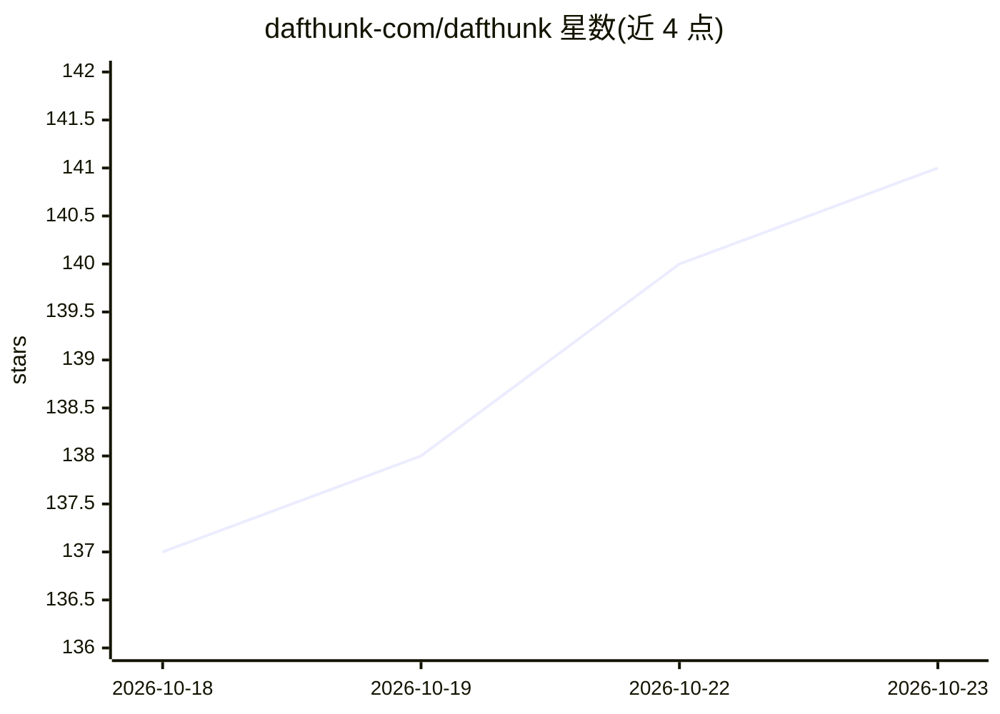

# dafthunk-com/dafthunk

⭐ 141 · TypeScript · MIT · 推送 2026-09-04 · [GitHub](https://github.com/dafthunk-com/dafthunk) · [官网](https://www.dafthunk.com) · 组织维护

**基于 Cloudflare 的可视化工作流自动化平台，含 AI 节点**

浏览器内拖拽式工作流编辑与执行平台，运行于 Cloudflare Workers/Workflows，用 D1、R2、KV 做持久化存储。节点类型 50+ 种，其中 AI 节点经 Cloudflare AI 实现文本摘要、情感分析、翻译、图像分类、音频转录与图像生成等。支持 HTTP API、邮件、Cloudflare Queue 消息触发工作流，提供 Gmail/Google Calendar/Discord/Reddit/LinkedIn/GitHub 集成的 OAuth 接入，并通过 GitHub/Google OAuth 做用户登录。部署需要 Cloudflare 账号，采用 pnpm monorepo（TypeScript + React 19 + Hono），安装为 git clone 源码并运行 pnpm 命令。

## 筛选速览

| 维度 | 判定 | 备注 |
|---|---|---|
| AI 角色 | `ai-enhanced` | 去掉 AI 部分产品仍成立 |
| 许可风险 | `permissive` | MIT |
| 部署形态 | `library` | 以包/库形式分发 |
| 模型依赖 | — | README 未给出锁定关系 |
| 硬件要求 | — | 无带数字的原话,不猜 |
| 安装摩擦 | `low` | 无编译、无系统依赖或容器化 |
| 成熟度 | — | 结构信号不足 |

## 能力要点

- React Flow 可视化拖拽工作流编辑器，50+ 节点类型
- AI 节点经 Cloudflare AI 做摘要/翻译/图像分类/转录/图像生成
- Cloudflare Workers 无服务器执行与 D1/R2/KV 持久化
- HTTP API、邮件、Queue 消息触发及 6 种第三方 OAuth 集成

## 适用场景

- 在浏览器里搭建和监控自动化工作流
- 把 AI 文本/图像/音频处理步骤编入低代码流程
- 用队列消息或 HTTP 触发多租户异步工作流

## 场景标签

`工作流自动化` · 领域:效率与自动化

## 证据(README 行号)

> L11: Daf·thunk is a powerful, visual workflow automation platform that allows you to create, manage, and execute workflo
> L18: - **AI-Powered Nodes**: Leverage Cloudflare AI for text summarization, sentiment analysis, translation, image class

## 星数曲线

2026-10-18 137 → 2026-10-23 141（+4）

---
*卡片 v1 · prompt 1.4 · 生成 2026-10-22 · 置信度 low · 依据 README sha `6907a4820edc` · [字段定义](../../DATASET.md)*
