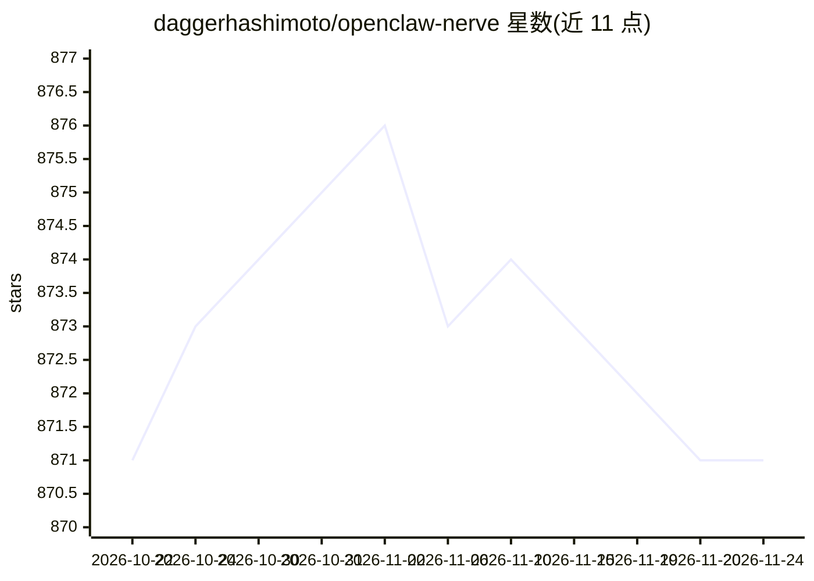

# daggerhashimoto/openclaw-nerve

⭐ 871 · TypeScript · MIT · 推送 2026-11-20 · [GitHub](https://github.com/daggerhashimoto/openclaw-nerve) · [官网](https://nerve.zone) · 个人维护

**OpenClaw 的自托管 Web 驾驶舱：语音对话、看板与 agent 舰队控制**

部署在 OpenClaw Gateway 之前的浏览器界面，将聊天线程之外的操作需求集中到一个控制平面：多 agent 管理（各带工作区、记忆、身份与技能）、推送对讲与唤醒词语音、本地 Whisper 转写与多 TTS 提供方、看板任务委派、cron 会话查看、文件浏览与在线编辑、token 用量与成本追踪。通过 install.sh 一键安装或 npm 源码构建，需要 Node.js 22+ 与一个 OpenClaw 网关，默认绑定 127.0.0.1，暴露网络时启用密码认证。

## 筛选速览

| 维度 | 判定 | 备注 |
|---|---|---|
| AI 角色 | `ai-ecosystem` | LLM/agent 周边工具 |
| 许可风险 | `permissive` | MIT |
| 部署形态 | `library` | 以包/库形式分发 |
| 模型依赖 | — | README 未给出锁定关系 |
| 硬件要求 | — | 无带数字的原话,不猜 |
| 安装摩擦 | `low` | 无编译、无系统依赖或容器化 |
| 成熟度 | — | 结构信号不足 |

## 能力要点

- 多 agent 舰队控制平面：工作区、记忆、身份、技能逐 agent 管理与实时检查
- 语音链路完整：推送对讲、唤醒词、本地 Whisper 转写、多 TTS 提供方、多语言停止短语
- 操作层能力：cron 调度、会话树、看板工作流、审查循环、提案收件箱
- 可观测性：token 用量、成本追踪、上下文压力表、agent 与事件日志

## 适用场景

- 同时运营多个 OpenClaw agent，统一切换上下文与检查状态
- 用看板给 agent 委派任务并审查产出
- 长任务运行时追踪 token 花费与上下文压力
- 在浏览器里实时浏览并编辑 agent 的工作区文件与记忆

## 场景标签

`多智能体` `LLM 可观测性` `语音 Agent` · 领域:Agent 开发

## 证据(README 行号)

> L125: Nerve sits in front of the gateway and gives you a richer operating surface in the browser.
> L38: Run multiple agents from one place. Each agent can have its own workspace, subagents, memory, identity, soul, and s

## 星数曲线

2026-10-22 871 → 2026-11-24 871（+0）

---
*卡片 v1 · prompt 1.4 · 生成 2026-11-24 · 置信度 high · 依据 README sha `969dc84cebbd` · [字段定义](../../DATASET.md)*
