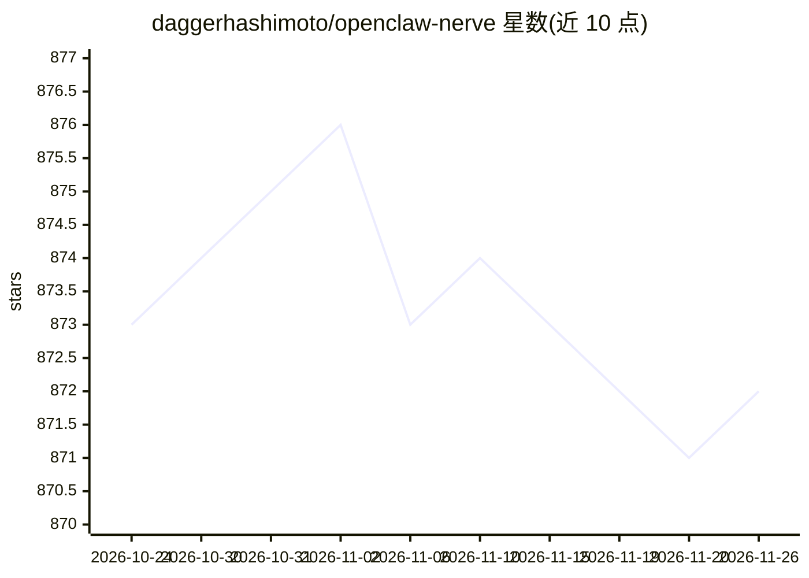

# daggerhashimoto/openclaw-nerve

⭐ 872 · TypeScript · MIT · 推送 2026-11-25 · [GitHub](https://github.com/daggerhashimoto/openclaw-nerve) · [官网](https://nerve.zone) · 个人维护

**OpenClaw 的自托管 Web 控制台：语音、看板与多 agent 管理**

为 OpenClaw 网关提供浏览器操作面的自托管 Web 界面，位于网关之前，通过 WS/SSE/REST 代理请求。支持在一个控制面运行多个 agent（各自的工作区、子 agent、记忆、身份与技能），提供流式聊天、本地 Whisper 语音转录与多 TTS、cron 调度、看板任务流、文件编辑器、token 用量与成本观测、内联图表与地图渲染。需 Node.js 22+、git 与 OpenClaw 网关，macOS/Linux 运行，默认仅绑定 127.0.0.1，联网需开启密码认证。

## 筛选速览

| 维度 | 判定 | 备注 |
|---|---|---|
| AI 角色 | `ai-ecosystem` | LLM/agent 周边工具 |
| 许可风险 | `permissive` | MIT |
| 部署形态 | `None` |  |
| 模型依赖 | — | README 未给出锁定关系 |
| 硬件要求 | — | 无带数字的原话,不猜 |
| 安装摩擦 | `low` | 无编译、无系统依赖或容器化 |
| 成熟度 | — | 结构信号不足 |

## 能力要点

- 多 agent 舰队控制面：工作区、记忆、身份与技能的切换与检查
- 语音对话：push-to-talk、唤醒词、本地 Whisper 转录、四个 TTS 提供商
- 运营层：cron 调度、kanban 任务板、评审流、提案收件箱、子 agent 会话树
- 观测：token 用量、成本、上下文压力、Claude Code 与 Codex 计划限额

## 适用场景

- 自托管 OpenClaw 后在浏览器里集中管理和操作多个 agent
- 用看板给 agent 派任务并评审结果
- 长时间任务运行中追踪 token 消耗与成本
- 通过语音与 agent 对话或远程访问控制台

## 场景标签

`多智能体` `语音 Agent` · 领域:Agent 开发

## 证据(README 行号)

> L159: ## How it fits into OpenClaw
> L164: Browser ─── Nerve (:3080) ─── OpenClaw Gateway (:18789)
> L39: Run multiple agents from one place. Each agent can have its own workspace, subagents, memory, identity, soul, and s

## 星数曲线

2026-10-24 873 → 2026-11-26 872（-1）

---
*卡片 v1 · prompt 1.4 · 生成 2026-11-25 · 置信度 high · 依据 README sha `8e0f885d1bf0` · [字段定义](../../DATASET.md)*
