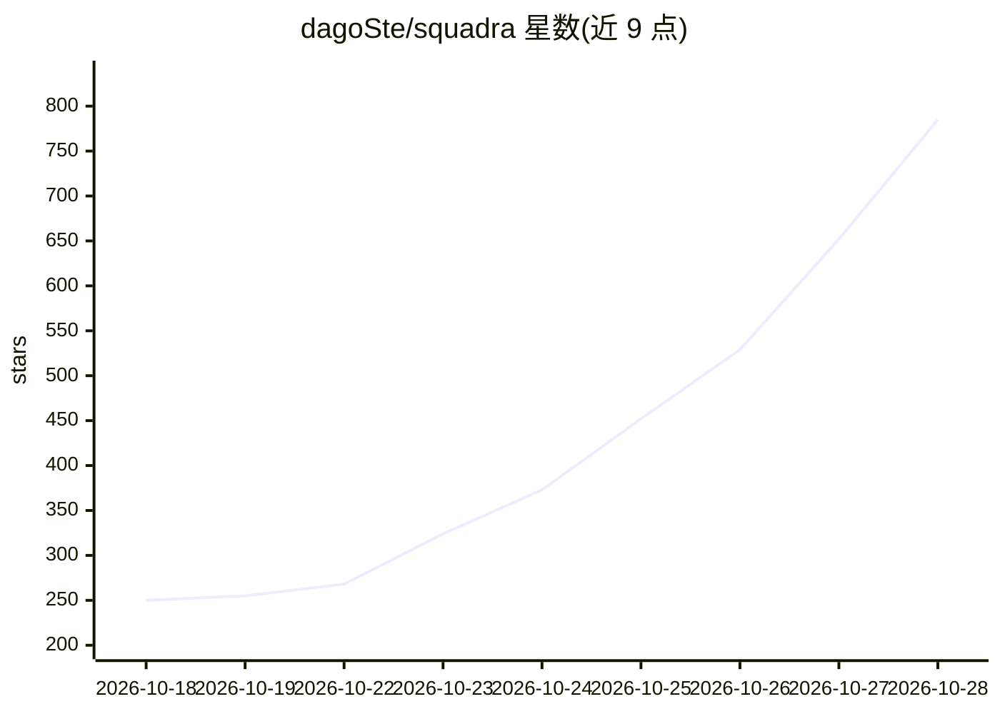

# dagoSte/squadra

⭐ 785 · Python · MIT · 推送 2026-10-27 · [GitHub](https://github.com/dagoSte/squadra) · 个人维护

**协调 Claude Code/Codex/Cursor 多窗口协作的本地团队技能工具**

面向使用多个 AI 编程代理窗口的开发者：让一个窗口协调、另一个修改、第三个（非作者）审查，形成确认→工作→检查→复审→关闭的流程。由技能（agent 遵循的规则）、CLI（记录每步）和本地双语仪表盘三部分组成；所有注册表、证明与决策保存在本机。证明与代码版本绑定，代码变更后证明失效；支持按窗口/模型统计 token 消耗。MIT 许可，仅依赖 Python 标准库，macOS/POSIX 为测试环境，Windows 进程控制未获认证。Cursor 窗口仅交互式使用，不被自动启动。

## 筛选速览

| 维度 | 判定 | 备注 |
|---|---|---|
| AI 角色 | `ai-ecosystem` | LLM/agent 周边工具 |
| 许可风险 | `permissive` | MIT |
| 部署形态 | `None` |  |
| 模型依赖 | locked-api |  |
| 硬件要求 | — | 无带数字的原话,不猜 |
| 安装摩擦 | `low` | 无编译、无系统依赖或容器化 |
| 成熟度 | — | 结构信号不足 |

## 能力要点

- 任务需接收方显式确认后才开始，作者不复审自己的代码
- 证明绑定代码版本，代码变更后证明与复审失效
- 本地注册表统一记录任务、证明与决策，双语仪表盘实时展示
- 按窗口/模型/任务统计 token 消耗并给出下一个任务的分配建议

## 适用场景

- 多个 AI 编程窗口共同开发一个项目时分配任务并互相审查
- 追踪代理工作的决策、证明与进度
- 统计各代理窗口的 token 花费并优化任务分配

## 场景标签

`多智能体` `代码审查` · 领域:Agent 开发

## 证据(README 行号)

> L52: Squadra lets several AI agent windows work on one project as a team you can follow: one window coordinates, another
> L7: The most complete team skill for Claude Code, Codex and Cursor.

## 星数曲线

2026-10-18 250 → 2026-10-28 785（+535）

---
*卡片 v1 · prompt 1.4 · 生成 2026-10-22 · 置信度 high · 依据 README sha `5536b5b3688d` · [字段定义](../../DATASET.md)*
