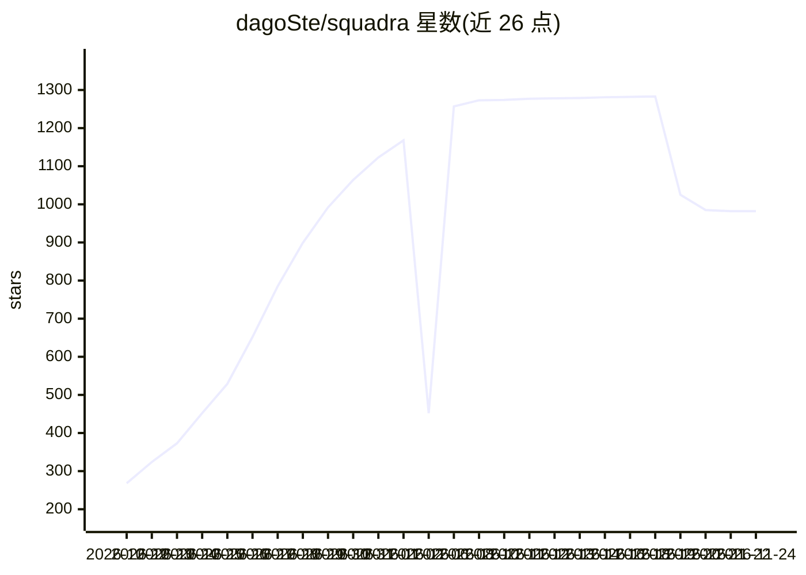

# dagoSte/squadra

⭐ 979 · Python · MIT · 推送 2026-11-22 · [GitHub](https://github.com/dagoSte/squadra) · 个人维护

**多窗口编码 Agent 的团队协调层：共享任务、复核与本地面板**

一个本地运行的 Python 工具，把多个 Claude Code、Codex、Cursor 窗口组成团队：一个窗口协调、其余构建、未参与编写的窗口做独立复核。任务分配、确认接收、预检查、并行测试、绑定源码的证据与复核报告记录在本地共享注册表中；提供 CLI、双语 Dashboard、token 用量视图、自动模型/力度选择配置，以及内置技能（经验回溯、代码简化、工作量预估）。MIT 许可，仅用 Python 标准库，macOS/POSIX 为已测试环境。

## 筛选速览

| 维度 | 判定 | 备注 |
|---|---|---|
| AI 角色 | `ai-ecosystem` | LLM/agent 周边工具 |
| 许可风险 | `permissive` | MIT |
| 部署形态 | `None` |  |
| 模型依赖 | — | README 未给出锁定关系 |
| 硬件要求 | — | 无带数字的原话,不猜 |
| 安装摩擦 | `low` | 无编译、无系统依赖或容器化 |
| 成熟度 | — | 结构信号不足 |

## 能力要点

- 写入者不复核机制：每处改动由未编写它的窗口复核
- 证据绑定到具体代码版本，代码变更后证据失效
- 本地 Dashboard 以英文/意大利语展示进度、决策与证据
- 按窗口/模型/任务统计 token 消耗并给出任务分配建议

## 适用场景

- 多个 Agent 会话并行开发同一项目时追踪每个任务归属与状态
- 让未参与编写的窗口独立复核代码变更
- 本地集中查看各 Agent 窗口的 token 开销与决策记录

## 场景标签

`多智能体` `编码 Agent` `代码审查` · 领域:Agent 开发

## 证据(README 行号)

> L7: Coordinate Claude Code, Codex and Cursor with shared tasks, independent reviews and a local dashboard.
> L23: Squadra helps several windows of coding agents work on one project as a team: one coordinates, others build, and a 
> L30: |**CLI**|Records tasks, messages, checks and decisions.|

## 星数曲线

2026-10-22 268 → 2026-11-24 982（+714）

---
*卡片 v1 · prompt 1.4 · 生成 2026-11-24 · 置信度 high · 依据 README sha `253fa0f9f01b` · [字段定义](../../DATASET.md)*
