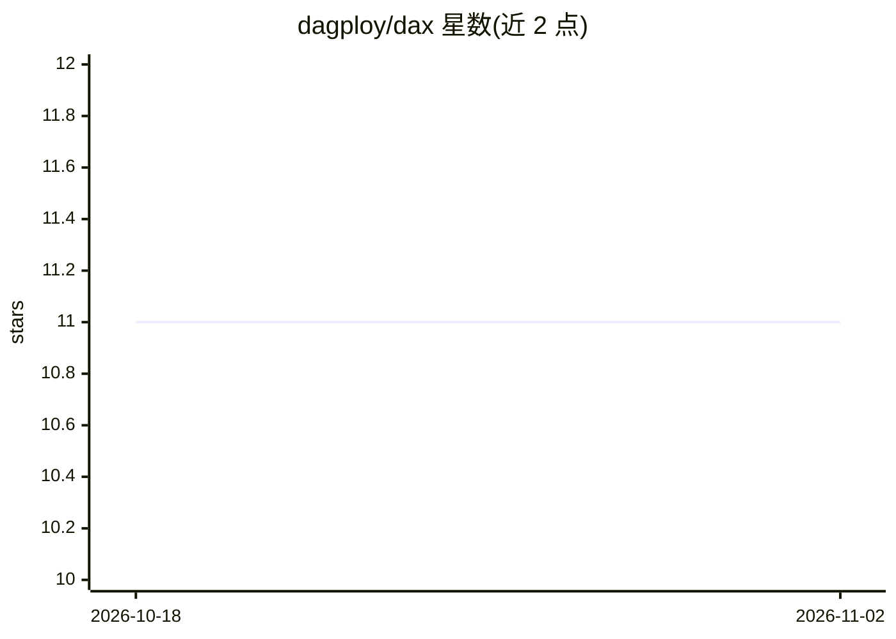

# dagploy/dax

⭐ 11 · Python · Apache-2.0 · 推送 2026-06-11 · [GitHub](https://github.com/dagploy/dax) · [官网](https://www.dagploy.com) · 组织维护

**在自有云中部署和管理自托管本地 AI 的 AIOps 基础设施工具**

基于 YAML 工作流在用户自己的云账号内构建与运行 AI 基础设施，覆盖推理、训练与 AI agent 环境的自动化编排。当前支持 GCP（AWS/Azure 列为未来开发），提供服务账号创建、Cloud NAT、VM 创建与安装脚本，约 5 分钟完成部署；通过 SSH 隧道以 CLI 或 curl 下发指令，并带 Dashboard。支持竞价实例、GPU 配额感知的区域切换、Docker 镜像与 Hugging Face 模型预缓存（示例为缓存后运行 GPT-OSS 20B，走 vLLM 容器与 Open WebUI）。仅限 GCP，需 GPU 配额且审批可能耗时 48 小时。

## 筛选速览

| 维度 | 判定 | 备注 |
|---|---|---|
| AI 角色 | `ai-ecosystem` | LLM/agent 周边工具 |
| 许可风险 | `permissive` | Apache-2.0 |
| 部署形态 | `self-host` | docker 或自建部署 |
| 模型依赖 | local-ok | 支持本地模型 |
| 硬件要求 | — | 无带数字的原话,不猜 |
| 安装摩擦 | `low` | 无编译、无系统依赖或容器化 |
| 成熟度 | — | 结构信号不足 |

## 能力要点

- YAML 工作流编排推理、训练与 agent 环境
- 支持竞价实例与 GPU 配额感知的区域切换
- Docker 镜像与 Hugging Face 模型预缓存机制，示例 15 分钟运行 GPT-OSS 20B
- 通过 SSH 隧道连接 CLI 与 Dashboard（Hatchet）

## 适用场景

- 在自己的 GCP 账号内部署自托管 LLM 推理服务
- 预缓存镜像与模型以缩短 GPU 工作负载启动时间
- 以基础设施即代码方式管理推理、训练与 AI agent 环境

## 场景标签

`推理引擎` · 领域:训练与推理

## 证据(README 行号)

> L3: Build and operate AI infrastructure inside your own cloud with YAML-based workflows at scale. Automate inference, tr
> L91: ### Run GPT OSS 20B in your cloud from scratch just takes *15 minutes*.
> L112: dax run create_vm_inference --stack-name gptoss --config-json '{"images":["models--openai--gpt-oss-20b","vllm-lib"

## 星数曲线

2026-10-18 11 → 2026-11-02 11（+0）

---
*卡片 v1 · prompt 1.4 · 生成 2026-11-02 · 置信度 mid · 依据 README sha `21aa41a730a8` · [字段定义](../../DATASET.md)*
