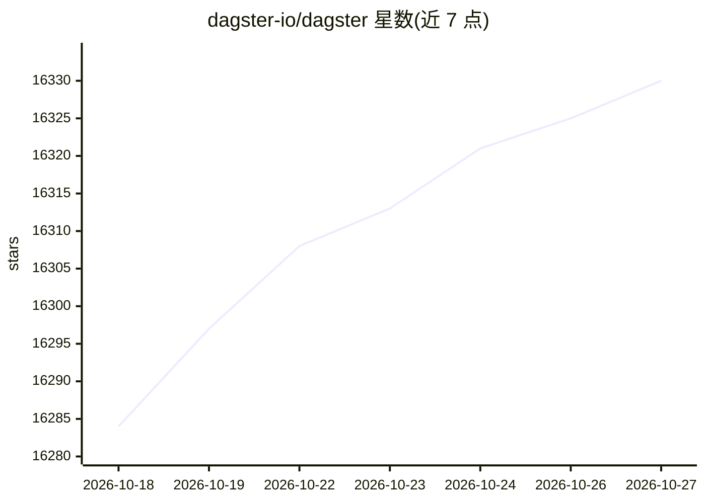

# dagster-io/dagster

⭐ 16,330 · Python · Apache-2.0 · 推送 2026-10-26 · [GitHub](https://github.com/dagster-io/dagster) · [官网](https://dagster.io) · 组织维护

**面向数据资产的管道编排平台，覆盖开发到生产全周期**

Dagster 是一个云原生数据管道编排器：以 Python 函数声明式定义数据资产（表、数据集、机器学习模型、报告），由平台在合适时机运行函数并保持资产更新。内置血缘追踪与可观测性、集中元数据管理、多租户编排引擎，支持本地开发、单元测试、集成测试到生产的完整生命周期。通过 PyPI 分发，官方支持 Python 3.9–3.14，提供 Web UI 与 dg CLI，并维护数据工具集成库。

## 筛选速览

| 维度 | 判定 | 备注 |
|---|---|---|
| AI 角色 | `ai-ecosystem` | LLM/agent 周边工具 |
| 许可风险 | `permissive` | Apache-2.0 |
| 部署形态 | `library` | 以包/库形式分发 |
| 模型依赖 | — | README 未给出锁定关系 |
| 硬件要求 | — | 无带数字的原话,不猜 |
| 安装摩擦 | `low` | 无编译、无系统依赖或容器化 |
| 成熟度 | — | 结构信号不足 |

## 动量与使用信号

- 维护:`active` — 距上次 push 1.5 天,年发版 50,407 位贡献者
- 涨星:近 1 天 **+2**(自 20261016 起算)
- 下载:GitHub Release 附件 累计 5,946(100 个 release)
- 平台:WEB · 协议:—

## 能力要点

- 以 Python 函数声明式定义数据资产并自动调度运行
- Web UI 中可视化资产血缘图，内置元数据编目与诊断
- 覆盖本地开发、单元/集成测试、staging 到生产的全生命周期
- 提供多租户、多工具的编排引擎与数据工具集成库

## 适用场景

- 编排 ETL 数据管道并保持数据表/数据集持续更新
- 管理机器学习模型与报告类资产的构建调度
- 集中查看数据资产的元数据、血缘与运行问题
- 在 CI/CD 流程中复用组件并及早发现数据质量问题

## 场景标签

`工作流自动化` `MLOps` · 领域:效率与自动化

## 证据(README 行号)

> L27: **Dagster is a cloud-native data pipeline orchestrator for the whole development lifecycle, with integrated lineage
> L29: It is designed for **developing and maintaining data assets**, such as tables, data sets, machine learning models, 
> L52: Dagster is available on PyPI and officially supports Python 3.9 through Python 3.14.

## 星数曲线

2026-10-18 16,284 → 2026-10-27 16,330（+46）

---
*卡片 v1 · prompt 1.4 · 生成 2026-10-18 · 置信度 high · 依据 README sha `6a308fecdb1e` · [字段定义](../../DATASET.md)*
