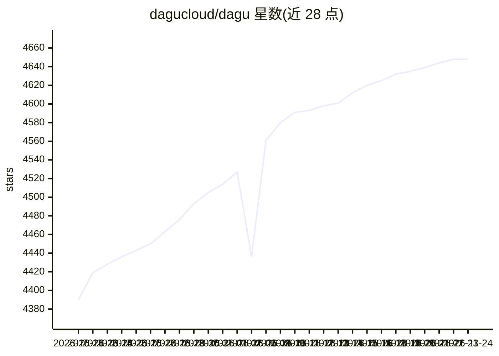

# dagucloud/dagu

⭐ 4,652 · Go · GPL-3.0 · 推送 2026-11-24 · [GitHub](https://github.com/dagucloud/dagu) · [官网](https://dagu.sh) · 组织维护

**自托管工作流编排器：用 YAML 管理脚本调度与依赖**

面向以内部自动化为日常工作的团队：把已有脚本、SSH 命令、容器等封装为声明式 YAML 的 DAG，工作流结构与业务逻辑分离，删除 YAML 后脚本可原样运行。单二进制文件、内置 Web UI、无外部数据库与消息中间件，支持 cron 调度、重试、人工任务、运行历史、子 DAG 复用、并发控制、MCP server 及单机/临时/分布式三种部署拓扑。社区自托管免费，SSO/RBAC/审计日志等功能需自托管许可证。

## 筛选速览

| 维度 | 判定 | 备注 |
|---|---|---|
| AI 角色 | `ai-enhanced` | 去掉 AI 部分产品仍成立 |
| 许可风险 | `dual` | GPL-3.0 |
| 部署形态 | `desktop` | 安装包/桌面程序 |
| 模型依赖 | — | README 未给出锁定关系 |
| 硬件要求 | — | 无带数字的原话,不猜 |
| 安装摩擦 | `low` | 无编译、无系统依赖或容器化 |
| 成熟度 | — | 结构信号不足 |

## 能力要点

- 单二进制安装，无外部数据库与消息中间件
- 声明式 YAML 定义 DAG，支持 shell/Docker/Kubernetes Jobs/SSH 步骤
- 内置 MCP server 用于查看、修改与控制工作流运行
- 支持单机、临时 worker、分布式 worker 三种部署拓扑

## 适用场景

- 把零散的 cron 定时脚本改成带依赖、重试和日志的 DAG
- 编排 ETL 与 dbt 数据处理流水线
- 通过 SSH 批量自动化远程服务器运维任务
- 在边缘或隔离网络上靠近数据源运行定时任务

## 场景标签

`工作流自动化` · 领域:效率与自动化

## 证据(README 行号)

> L15: Dagu is a local-first workflow engine for operations and internal automation. It is open source and self-hostable: 
> L29: - Built-in MCP server for inspecting workflows and runs, maintaining Wiki pages, applying changes, and controlling 
> L203: - **Self-host license:** Adds SSO, RBAC, audit logging, incident SaaS integration, and monitoring in Dagu Console 

## 星数曲线

2026-10-21 4,390 → 2026-11-24 4,648（+258）

---
*卡片 v1 · prompt 1.4 · 生成 2026-11-24 · 置信度 high · 依据 README sha `960b00ece8a4` · [字段定义](../../DATASET.md)*
