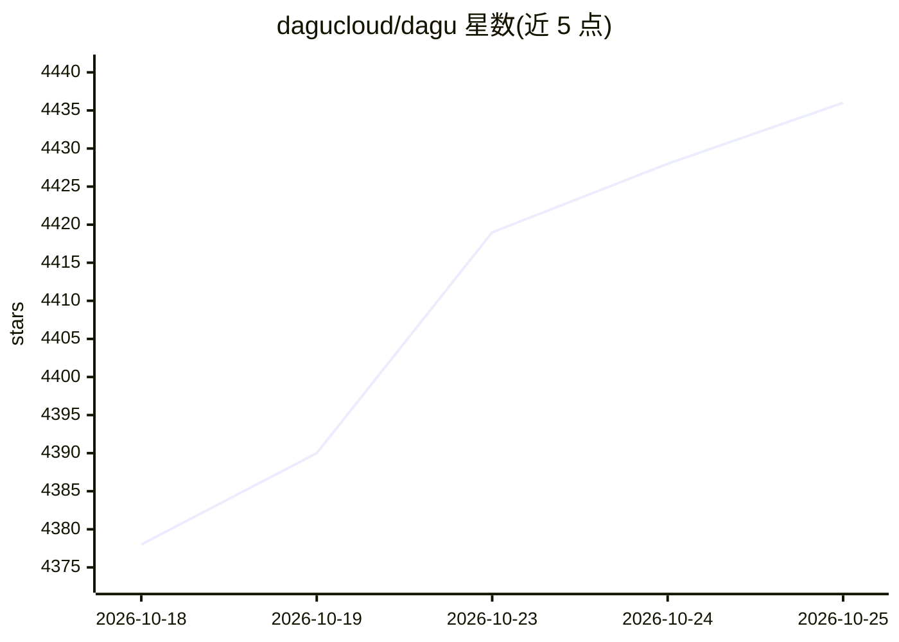

# dagucloud/dagu

⭐ 4,443 · Go · GPL-3.0 · 推送 2026-10-25 · [GitHub](https://github.com/dagucloud/dagu) · [官网](https://dagu.sh) · 组织维护

**单二进制工作流编排引擎，把脚本/容器/SSH 变成可调度的 DAG**

本地优先的开源自托管工作流引擎：以声明式 YAML 定义 DAG，原生执行 shell 命令、Docker 容器、Kubernetes Jobs 与 SSH 远程命令，提供调度、重试、人工任务、运行历史与内置 Web UI。无需外部数据库或消息 broker，单个二进制可跑在 Linux/macOS/Windows，状态存本地文件，支持从单机扩展到 worker 集群。内置 MCP server 供检查与控制工作流，供 AI agent 调用。可选的 Dagu Console 监控为云服务（beta），另有付费 self-host 许可增加 SSO/RBAC 等功能。

## 筛选速览

| 维度 | 判定 | 备注 |
|---|---|---|
| AI 角色 | `ai-enhanced` | 去掉 AI 部分产品仍成立 |
| 许可风险 | `dual` | GPL-3.0 |
| 部署形态 | `self-host` | docker 或自建部署 |
| 模型依赖 | — | README 未给出锁定关系 |
| 硬件要求 | — | 无带数字的原话,不猜 |
| 安装摩擦 | `low` | 无编译、无系统依赖或容器化 |
| 成熟度 | — | 结构信号不足 |

## 能力要点

- 单二进制部署，无需外部数据库或消息 broker，内置 Web UI
- YAML 声明式 DAG，原生支持 shell/Docker/Kubernetes Job/SSH 步骤
- cron 调度、重试、人工任务、运行历史与密钥管理
- 内置 MCP server 用于检查与控制工作流运行

## 适用场景

- 把已有脚本和 cron 任务改造成有依赖、重试与日志的 DAG
- 在本地或内网环境调度 ETL、媒体转码与服务器自动化任务
- 让 AI agent 通过 MCP 检查和控制工作流
- 为非工程团队提供自助式诊断与运维工作流

## 场景标签

`工作流自动化` · 领域:效率与自动化

## 证据(README 行号)

> L15: Dagu is a local-first workflow engine for operations and internal automation. It is open source and self-hostable: 
> L29: - Built-in MCP server for inspecting workflows and runs, maintaining Wiki pages, applying changes, and controlling 
> L191: - **Community self-host:** No license key required. You operate the server, storage, upgrades, networking, and wor

## 星数曲线

2026-10-18 4,378 → 2026-10-25 4,436（+58）

---
*卡片 v1 · prompt 1.4 · 生成 2026-10-20 · 置信度 high · 依据 README sha `b6f9e1e9b866` · [字段定义](../../DATASET.md)*
