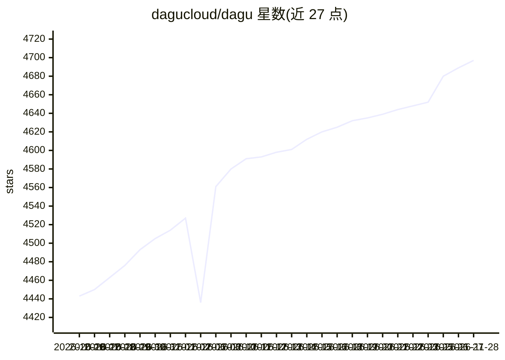

# dagucloud/dagu

⭐ 4,697 · Go · GPL-3.0 · 推送 2026-11-27 · [GitHub](https://github.com/dagucloud/dagu) · [官网](https://dagu.sh) · 组织维护

**单二进制自托管工作流引擎：为非编排团队编排脚本与作业**

本地优先的 workflow 引擎，以声明式 YAML 定义 DAG，原生执行 shell 命令、Docker 容器、Kubernetes Job、SSH 远程命令，无需外部数据库或消息代理，提供内置 Web UI、cron 调度、重试、人工任务、运行历史与内置 MCP server。面向主要工作不是编排的团队，把现有脚本变成生产流水线。提供 Homebrew/npm/安装包/Docker/Helm 多种安装方式；商业功能（SSO/RBAC/审计）需自托管付费许可。

## 筛选速览

| 维度 | 判定 | 备注 |
|---|---|---|
| AI 角色 | `ai-enhanced` | 去掉 AI 部分产品仍成立 |
| 许可风险 | `dual` | GPL-3.0 |
| 部署形态 | `desktop` | 安装包/桌面程序 |
| 模型依赖 | — | README 未给出锁定关系 |
| 硬件要求 | — | 无带数字的原话,不猜 |
| 安装摩擦 | `low` | 无编译、无系统依赖或容器化 |
| 成熟度 | — | 结构信号不足 |

## 能力要点

- 单二进制、无外部数据库/消息代理，可在受限硬件上运行
- YAML 声明式定义 DAG，脚本无需引入编排框架
- 内置 MCP server 用于检查/修改/控制工作流
- 单机到分布式 worker 三种部署拓扑（gRPC 出站轮询）

## 适用场景

- 把 cron 作业替换为带依赖、重试与日志的 DAG
- ETL 脚本与 dbt 命令编排成可观测数据流水线
- 通过 SSH 在内网/隔离环境运行服务器自动化
- 从 GitHub 事件触发私有基础设施上的自动化

## 场景标签

`工作流自动化` · 领域:效率与自动化

## 证据(README 行号)

> L15: Dagu is a local-first workflow engine for operations and internal automation. It is open source and self-hostable: 
> L29: - Built-in MCP server for inspecting workflows and runs, maintaining Wiki pages, applying changes, and controlling 
> L220: - **Language-agnostic:** No framework required. Define workflow steps using shell commands, Docker containers, Kub

## 星数曲线

2026-10-26 4,443 → 2026-11-28 4,697（+254）

---
*卡片 v1 · prompt 1.4 · 生成 2026-11-28 · 置信度 high · 依据 README sha `b22ae210c2db` · [字段定义](../../DATASET.md)*
