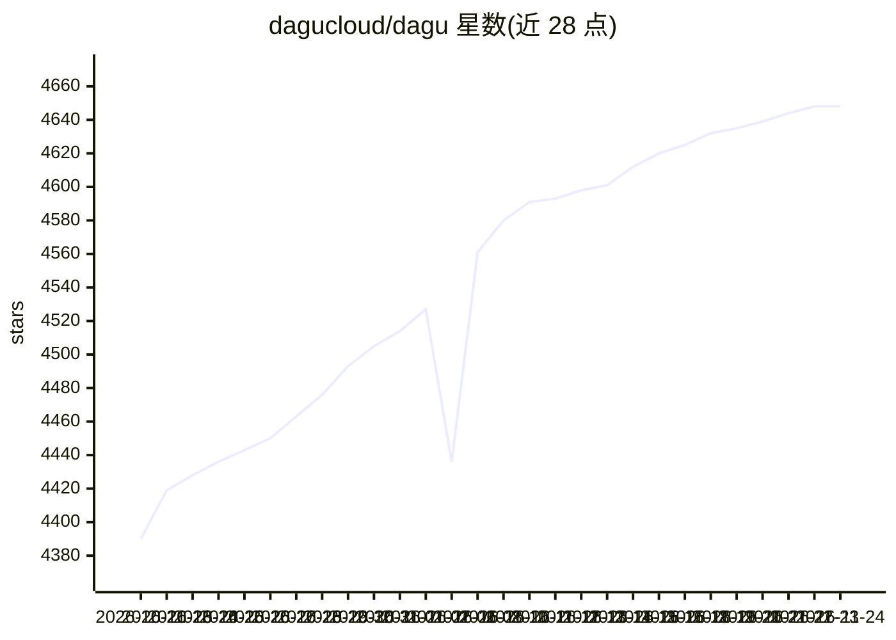

# dagucloud/dagu

⭐ 4,648 · Go · GPL-3.0 · 推送 2026-11-22 · [GitHub](https://github.com/dagucloud/dagu) · [官网](https://dagu.sh) · 组织维护

**给非编排团队用的自托管工作流引擎：YAML 定义 DAG**

本地优先的自托管工作流引擎：单个二进制内置 Web UI，无需外部数据库或消息代理，运行在 Linux/macOS/Windows。以声明式 YAML 定义 DAG，工作流结构与业务脚本分离，脚本无需引入框架代码。原生执行 shell 命令、Docker 容器、Kubernetes Jobs 与 SSH 远程命令，提供 cron 调度、重试、Sub-DAG 复用、运行历史、人工任务、Webhook 触发与内置 MCP server。社区自托管免费，商业功能（SSO/RBAC/审计）需自托管许可。

## 筛选速览

| 维度 | 判定 | 备注 |
|---|---|---|
| AI 角色 | `ai-enhanced` | 去掉 AI 部分产品仍成立 |
| 许可风险 | `dual` | GPL-3.0 |
| 部署形态 | `desktop` | 安装包/桌面程序 |
| 模型依赖 | — | README 未给出锁定关系 |
| 硬件要求 | — | 无带数字的原话,不猜 |
| 安装摩擦 | `low` | 无编译、无系统依赖或容器化 |
| 成熟度 | — | 结构信号不足 |

## 能力要点

- 单二进制安装，无外部 DBMS 或消息代理
- 声明式 YAML 定义 DAG，脚本不 import 编排器，删除 YAML 脚本可独立运行
- 支持 shell/Docker/Kubernetes Jobs/SSH 远程命令等多种步骤类型
- 内置 MCP server 用于检查与控制工作流，人工任务支持暂停与输入

## 适用场景

- 把数据抽取脚本、SQL、dbt 命令编排成可观测的 ETL 流水线
- 替代 cron 管理带依赖、重试与历史记录的定时脚本
- 通过 SSH 在私有服务器上运行运维自动化并集中收集日志
- 给非工程团队提供自助式诊断与查询工作流

## 场景标签

`工作流自动化` · 领域:效率与自动化

## 证据(README 行号)

> L15: Dagu is a local-first workflow engine for operations and internal automation. It is open source and self-hostable: 
> L29: - Built-in MCP server for inspecting workflows and runs, maintaining Wiki pages, applying changes, and controlling 

## 星数曲线

2026-10-21 4,390 → 2026-11-24 4,648（+258）

---
*卡片 v1 · prompt 1.4 · 生成 2026-11-23 · 置信度 high · 依据 README sha `f2e96798494d` · [字段定义](../../DATASET.md)*
