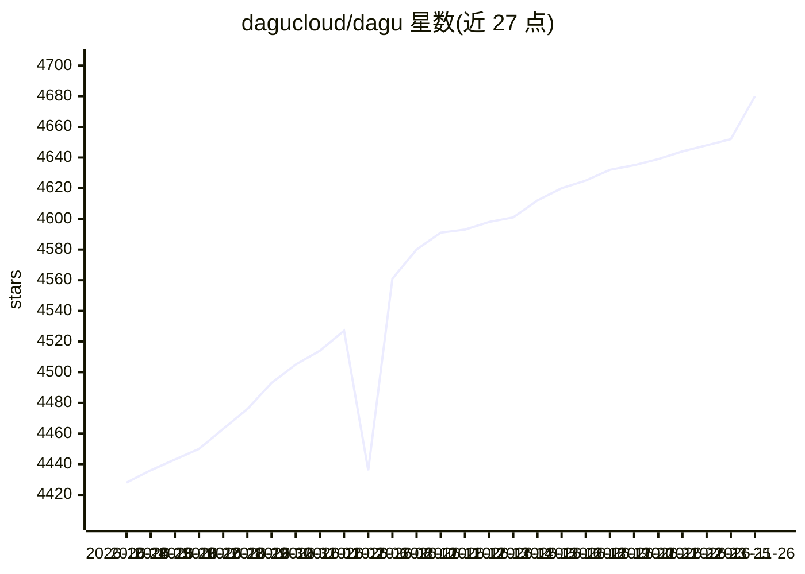

# dagucloud/dagu

⭐ 4,680 · Go · GPL-3.0 · 推送 2026-11-25 · [GitHub](https://github.com/dagucloud/dagu) · [官网](https://dagu.sh) · 组织维护

**给非编排团队的本地优先工作流编排器：YAML 声明调度脚本与容器**

Dagu 是自托管的本地优先工作流引擎：单个二进制内置 Web UI，无外部数据库或消息中间件，运行于 Linux/macOS/Windows。以声明式 YAML 定义 DAG，原生执行 shell 命令、Docker 容器、Kubernetes Job、SSH 远程命令；提供 cron 调度、重试、依赖管理、运行历史、人工任务（暂停等待操作员确认/输入）与内置 MCP server 供检查和控制工作流。面向主要工作不是编排的团队，将现有脚本转为生产工作流。提供社区自托管与付费 self-host 许可（SSO/RBAC/审计）两级。

## 筛选速览

| 维度 | 判定 | 备注 |
|---|---|---|
| AI 角色 | `ai-enhanced` | 去掉 AI 部分产品仍成立 |
| 许可风险 | `dual` | GPL-3.0 |
| 部署形态 | `desktop` | 安装包/桌面程序 |
| 模型依赖 | — | README 未给出锁定关系 |
| 硬件要求 | — | 无带数字的原话,不猜 |
| 安装摩擦 | `low` | 无编译、无系统依赖或容器化 |
| 成熟度 | — | 结构信号不足 |

## 能力要点

- 单二进制安装，无需外部 DBMS 或消息中间件
- 声明式 YAML 定义 DAG，工作流结构与业务脚本分离
- 支持 shell/Docker 容器/Kubernetes Job/SSH 远程命令执行
- 内置 MCP server 与人工任务（human-in-the-loop）步骤

## 适用场景

- 把 cron 定时脚本升级为带依赖、重试和日志的 DAG
- 将 ETL 脚本和 dbt 命令编排为可观测的数据管道
- 通过 SSH 批量执行远程服务器运维命令并集中留存日志
- 在边缘/离线环境就近运行数据预处理和备份任务

## 场景标签

`工作流自动化` · 领域:效率与自动化

## 证据(README 行号)

> L15: Dagu is a local-first workflow engine for operations and internal automation. It is open source and self-hostable: 
> L29: - Built-in MCP server for inspecting workflows and runs, maintaining Wiki pages, applying changes, and controlling 
> L223: - **Human Tasks:** Pause a workflow for acknowledgement or typed operator input, then expose the response to downs

## 星数曲线

2026-10-24 4,428 → 2026-11-26 4,680（+252）

---
*卡片 v1 · prompt 1.4 · 生成 2026-11-26 · 置信度 mid · 依据 README sha `d34a8fccd88f` · [字段定义](../../DATASET.md)*
