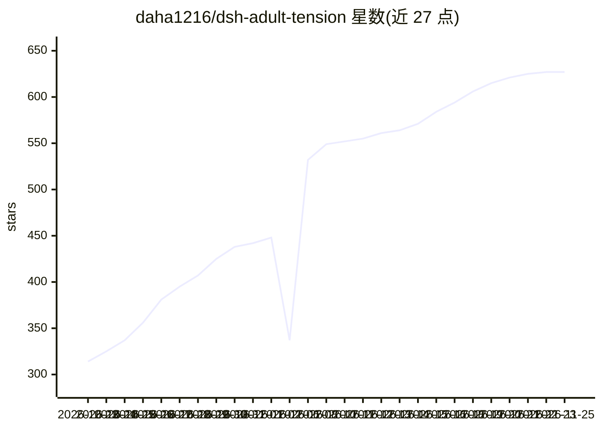

# daha1216/dsh-adult-tension

⭐ 627 · Python · 推送 2026-11-23 · [GitHub](https://github.com/daha1216/dsh-adult-tension) · 个人维护 · 中文 README

**面向 Agent 宿主的成人互动叙事 Skill：活人感 NPC 与零漂移存档**

一个安装在 Agent 宿主（DSH/Claude Code/Codex/OpenCode/pi）中的原生 SKILL，用于运行 18+ 互动叙事游戏。模型负责生成文本，本地 Python 运行时用 SQLite 状态机维护人物、关系、时间与事实，提供 211 个内置世界、15,000+ 叙事素材、命名存档/导入导出、尺度与节奏调节、硬边界拦截等指令。安装仅需把 skill 目录复制到宿主 Skill 目录，无需 pip/API Key，存档存于本地用户数据目录。仅限成年用户。

## 筛选速览

| 维度 | 判定 | 备注 |
|---|---|---|
| AI 角色 | `ai-native` | 本体是模型或模型工具 |
| 许可风险 | `none` | — |
| 部署形态 | `library` | 以包/库形式分发 |
| 模型依赖 | — | README 未给出锁定关系 |
| 硬件要求 | — | 无带数字的原话,不猜 |
| 安装摩擦 | `low` | 无编译、无系统依赖或容器化 |
| 成熟度 | — | 结构信号不足 |

## 能力要点

- 本地 SQLite 状态机保存人物、关系与时间，长对话上下文不超过 32 KB
- NPC 回应分拒绝、协商、有限配合、表面配合、真诚配合五档
- 211 个内置世界与 15,753 项叙事素材，支持自定义世界
- 存档支持命名、分支、导入导出，升级前自动备份迁移

## 适用场景

- 在 Claude Code 等宿主里玩长线连续的成人向互动小说
- 用自定义设定开局，并跨会话接续同一存档
- 需要剧情事实不随对话漂移的长篇叙事体验

## 场景标签

`聊天机器人` · 领域:对话与助手

## 证据(README 行号)

> L5: ### dsh-adult-tension 专为高张力、强连续性的成人互动叙事打造
> L178: - **需要一个能运行本地命令的 Agent 宿主**，比如上表里的几个。宿主怎么把对话发给模型，由宿主和你选的模型服务决定；存档只存在你自己的电脑上。

## 星数曲线

2026-10-23 314 → 2026-11-25 627（+313）

---
*卡片 v1 · prompt 1.4 · 生成 2026-11-25 · 置信度 mid · 依据 README sha `2340260105ca` · [字段定义](../../DATASET.md)*
