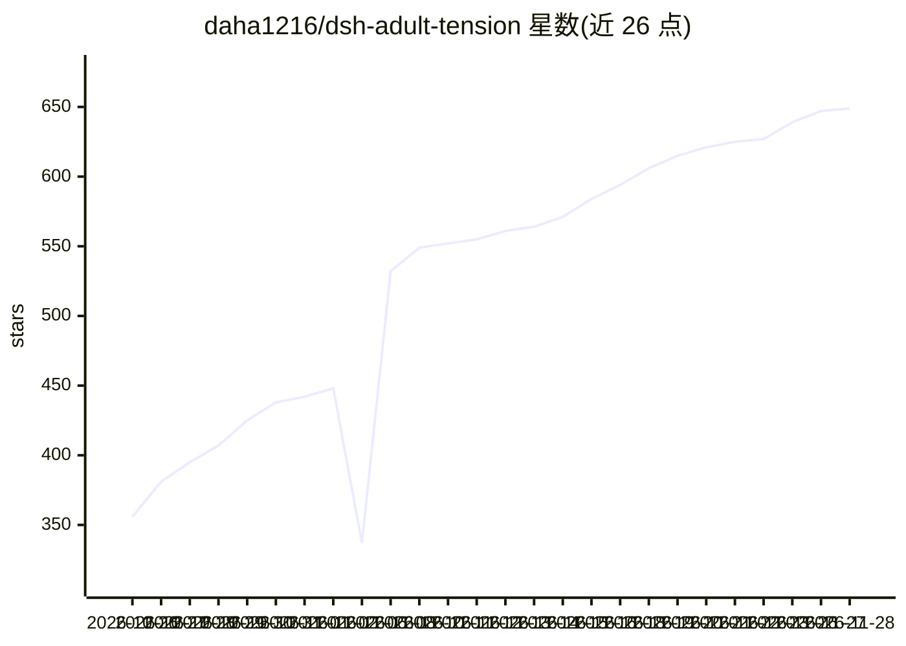

# daha1216/dsh-adult-tension

⭐ 649 · Python · 推送 2026-11-26 · [GitHub](https://github.com/daha1216/dsh-adult-tension) · 个人维护 · 中文 README

**面向 18+ 用户的互动叙事 Agent Skill，提供成人角色扮演故事生成**

以原生 Agent Skill 形式安装到 Claude Code、Codex、OpenCode、DSH 等宿主中的互动叙事系统：用户在对话中用自然语言开局、推进、调档，模型生成叙事正文；本地运行时（Python 标准库 + SQLite）维护人物、关系、时间线与存档，执行硬边界拦截与普通回合零工具调用的批量记账。内置 211 个世界与 15,000 余项素材，支持自定义世界与尺度分档。仅限 18+ 用户，存档只存本地。

## 筛选速览

| 维度 | 判定 | 备注 |
|---|---|---|
| AI 角色 | `ai-native` | 本体是模型或模型工具 |
| 许可风险 | `none` | — |
| 部署形态 | `library` | 以包/库形式分发 |
| 模型依赖 | — | README 未给出锁定关系 |
| 硬件要求 | — | 无带数字的原话,不猜 |
| 安装摩擦 | `low` | 无编译、无系统依赖或容器化 |
| 成熟度 | — | 结构信号不足 |

## 能力要点

- 211 个内置世界与 15,753 项叙事素材，支持自定义世界现造
- 本地 SQLite 状态机守事实，常规上下文 ≤6KB，存档不漂移
- NPC 五档回应（拒绝/协商/有限配合等）与表里双面语态
- 尺度/节奏/人称随时切换，暂停与硬边界由本地引擎强制执行

## 适用场景

- 在 Agent 宿主里开一局成人互动叙事并持续推进剧情
- 用存档/读档/导入导出在多台设备间接续同一故事
- 自定义世界与主角身份后反复开局体验不同剧情线

## 场景标签

`聊天机器人` · 领域:对话与助手

## 证据(README 行号)

> L9: 支持 Claude Code · Codex · OpenCode · DSH 等
> L143: 帮我安装这个 skill：https://github.com/daha1216/dsh-adult-tension （Skill 在 skill/adult-tension 目录）
> L184: - **仅限成年人（18+）。** 所有人物与情节均为虚构，全员明确成年；玩家随时可喊“暂停”或划定硬边界，由本地引擎强制拦截，不靠模型自觉。

## 星数曲线

2026-10-26 356 → 2026-11-28 649（+293）

---
*卡片 v1 · prompt 1.4 · 生成 2026-11-26 · 置信度 mid · 依据 README sha `bed68cea89a4` · [字段定义](../../DATASET.md)*
