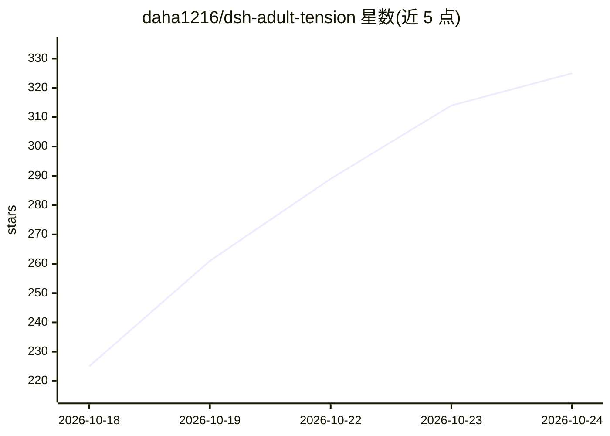

# daha1216/dsh-adult-tension

⭐ 325 · Python · 推送 2026-10-23 · [GitHub](https://github.com/daha1216/dsh-adult-tension) · 个人维护 · 中文 README

**18+ 高张力成人互动叙事引擎：活人感 NPC 与 211 个世界**

面向 dsh（DeepSeek 宿主）的原生 Agent Skill 插件，提供成人向高张力互动叙事：内置 211 个可直接开局的世界与一万四千余项素材（970+ 地点、1270+ NPC、910+ 张力引擎、3330+ 开场钩子等），NPC 具备自主决策、可拒绝玩家请求的行为逻辑；以本地 SQLite 状态机维护时间/地点/回合等状态，按项目说明由模型生成叙事、本地引擎维护事实以避免状态漂移。README 展示了真实试玩会话记录与世界观清单。

## 筛选速览

| 维度 | 判定 | 备注 |
|---|---|---|
| AI 角色 | `ai-native` | 本体是模型或模型工具 |
| 许可风险 | `none` | — |
| 部署形态 | `library` | 以包/库形式分发 |
| 模型依赖 | — | README 未给出锁定关系 |
| 硬件要求 | — | 无带数字的原话,不猜 |
| 安装摩擦 | `low` | 无编译、无系统依赖或容器化 |
| 成熟度 | — | 结构信号不足 |

## 能力要点

- 211 个已开放世界与一万四千余项素材库
- SQLite 状态机维护时间/地点/回合，避免状态漂移
- NPC 自主决策、可拒绝玩家，不无条件顺从
- 支持自定义世界，按需求现场生成

## 适用场景

- 直接挑选内置世界进行 18+ 互动叙事
- 自定义年代与场景生成专属世界开局
- 体验 NPC 有底线、有自主拒绝的叙事会话

## 场景标签

`聊天机器人` `AI 写作` · 领域:对话与助手

## 证据(README 行号)

> L5: ### dsh-adult-tension 专为高张力、强连续性的成人互动叙事打造
> L9: 数千余项素材库 ｜ 零漂移 SQLite 状态机
> L260:  出自真实试玩记录，宿主 opencode，模型 gemini-3.8-flash，删节处用“……”标出。全文：`opencode-pt-harbor_night_shift-pressure-r3.json` · 全部试玩与评

## 星数曲线

2026-10-18 225 → 2026-10-24 325（+100）

---
*卡片 v1 · prompt 1.4 · 生成 2026-10-22 · 置信度 high · 依据 README sha `0da841ae4db0` · [字段定义](../../DATASET.md)*
