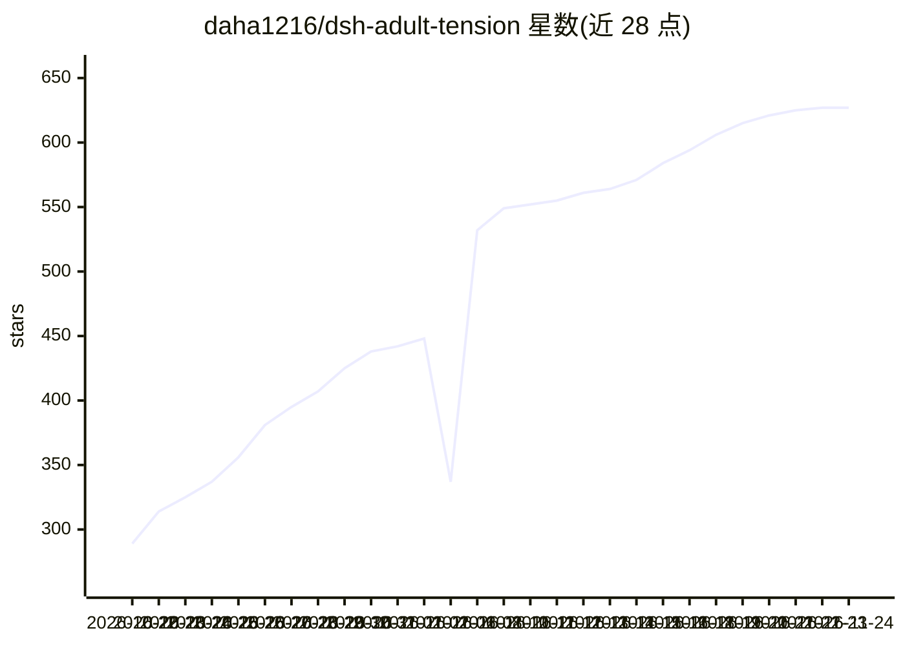

# daha1216/dsh-adult-tension

⭐ 627 · Python · 推送 2026-11-23 · [GitHub](https://github.com/daha1216/dsh-adult-tension) · 个人维护 · 中文 README

**面向成年人的 Agent Skill 18+ 互动叙事：活人感 NPC 与零漂移存档**

以 Agent Skill 形式安装到宿主（DSH/Claude Code/Codex/OpenCode 等）的成人向互动叙事内容包：模型负责写故事，本地 Python 运行时用 SQLite 状态机守护事实，维持人物关系、时间线与存档不漂移。内置 211 个世界与上万条素材（地点、NPC、开场钩子等），NPC 按五档回应可拒绝玩家；支持自定义世界、命名存档、导入导出与快进。仅限成年人使用，出文质量依赖所接入的模型。

## 筛选速览

| 维度 | 判定 | 备注 |
|---|---|---|
| AI 角色 | `ai-native` | 本体是模型或模型工具 |
| 许可风险 | `none` | — |
| 部署形态 | `library` | 以包/库形式分发 |
| 模型依赖 | — | README 未给出锁定关系 |
| 硬件要求 | — | 无带数字的原话,不猜 |
| 安装摩擦 | `low` | 无编译、无系统依赖或容器化 |
| 成熟度 | — | 结构信号不足 |

## 能力要点

- 模型写故事、本地 SQLite 引擎守事实的分工架构
- NPC 回应分拒绝/协商/有限配合等五档，不无条件顺从
- 211 个世界、一万四千余项素材，支持自然语言自定义世界
- 命名存档、另存为、导入导出，重试不重复推进

## 适用场景

- 在 Agent 宿主里玩长线连贯的成人互动叙事
- 自定义设定一个世界并保存反复开局
- 跨设备导出导入存档继续游戏

## 场景标签

 · 领域:游戏/互动叙事

## 证据(README 行号)

> L5: ### dsh-adult-tension 专为高张力、强连续性的成人互动叙事打造
> L110: 不需要 `pip install`，不需要设环境变量，也不需要任何 API Key。
> L169: 运行时只用 Python 标准库；SQLite 是唯一的状态存储，只有一个写入口。每个写操作都带 `request_id`，会话内的还带 `expected_revision`，重试不会重复推进。

## 星数曲线

2026-10-22 289 → 2026-11-24 627（+338）

---
*卡片 v1 · prompt 1.4 · 生成 2026-11-24 · 置信度 mid · 依据 README sha `ef02217f17e9` · [字段定义](../../DATASET.md)*
