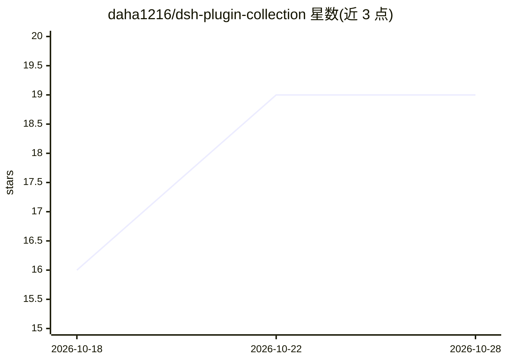

# daha1216/dsh-plugin-collection

⭐ 20 · PowerShell · 推送 2026-10-26 · [GitHub](https://github.com/daha1216/dsh-plugin-collection) · 个人维护 · 中文 README

**DeepSeek Harness 第三方插件精选目录：索引、安装与更新命令**

面向 DeepSeek Harness（DSH）用户的第三方插件索引仓库：只维护目录条目、安装入口与更新命令，不复制插件源码，每个条目指向插件作者原仓库或官方 npm 构建包。收录 12 个插件，覆盖模型与推理增强、上下文计量、会话效率、界面与多端协同四类。安装通过 DSH 官方 CLI（npx @deepseek-ai/dsh）单装、仓库脚本按需装或一键全量装；另维护 plugins.json 单一数据源与自动对账脚本，附更新机制与主题令牌避坑说明。

## 筛选速览

| 维度 | 判定 | 备注 |
|---|---|---|
| AI 角色 | `ai-knowledge` | 知识聚合/清单类 |
| 许可风险 | `none` | — |
| 部署形态 | `library` | 以包/库形式分发 |
| 模型依赖 | locked-api |  |
| 硬件要求 | — | 无带数字的原话,不猜 |
| 安装摩擦 | `low` | 无编译、无系统依赖或容器化 |
| 成熟度 | — | 结构信号不足 |

## 能力要点

- 12 个插件按 4 类组织，条目均指向上游原仓库
- 提供单装、交互式选择与一键全量安装三种途径，统一走 DSH 官方 CLI
- 更新命令表逐条引用各插件上游 README 的原生写法
- plugins.json 单一数据源 + verify.ps1 自动对账校验目录一致性

## 适用场景

- 为 DSH 挑选并安装提升使用效率的第三方插件
- 查看各插件的原生更新命令并完成升级
- 插件开发者了解 DSH 主题令牌与 Registry 缓存的注意事项

## 场景标签

`精选清单` · 领域:学习与行业

## 证据(README 行号)

> L3: > DeepSeek Harness（DSH）第三方插件精选目录与原生更新命令索引。
> L10: 本仓库**只维护插件索引、安装入口与原生更新命令，不复制或重新发布任何插件源码**。每个条目均严格指向插件作者原仓库或官方发布的 npm 构建包。收录标准聚焦于日常真实使用，只收能切实提升 DSH 体验与效率的插件。

## 星数曲线

2026-10-18 16 → 2026-10-28 19（+3）

---
*卡片 v1 · prompt 1.4 · 生成 2026-10-28 · 置信度 high · 依据 README sha `5b09d230a3fd` · [字段定义](../../DATASET.md)*
