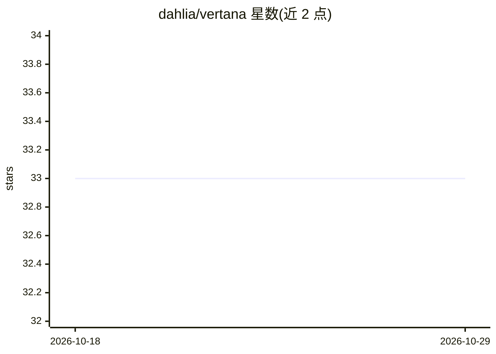

# dahlia/vertana

⭐ 33 · TypeScript · MIT · 推送 2026-05-05 · [GitHub](https://github.com/dahlia/vertana) · [官网](http://vertana.org/) · 个人维护

**面向 TypeScript/JavaScript 的 LLM 代理式翻译库**

TypeScript/JavaScript 翻译库，通过自主 agent 工作流在翻译前采集上下文，而不只是简单提示 LLM。提供内容感知分块（纯文本/Markdown/HTML）、静态与动态术语表、按准确度/流畅度/术语/风格评估质量、低分块迭代重译、多模型 Best-of-N 选择与进度回调。以 monorepo 多包形式发布于 JSR 与 npm，支持 Deno/Node.js/Bun 运行时。README 声明处于早期概念验证阶段，API 可能变更，尚不适合生产使用。

## 筛选速览

| 维度 | 判定 | 备注 |
|---|---|---|
| AI 角色 | `ai-native` | 本体是模型或模型工具 |
| 许可风险 | `permissive` | MIT |
| 部署形态 | `None` |  |
| 模型依赖 | — | README 未给出锁定关系 |
| 硬件要求 | — | 无带数字的原话,不猜 |
| 安装摩擦 | `low` | 无编译、无系统依赖或容器化 |
| 成熟度 | `idea` | |

## 能力要点

- agent 工作流在翻译前调用外部来源采集上下文
- 支持 Markdown/HTML 的内容感知分块与 token 上限控制
- 静态与跨块累积的动态术语表
- 多模型 Best-of-N 选择与低分块迭代重译

## 适用场景

- 在 TypeScript 项目中集成 LLM 驱动的文档/文本翻译
- 需要术语一致性与翻译记忆的多语言内容处理
- 对翻译质量做多维度评估与自动精炼

## 场景标签

 · 领域:LLM 应用/翻译工具

## 证据(README 行号)

> L12: Vertana[^1] is an LLM-powered agentic translation library for
> L13: TypeScript/JavaScript. It goes beyond simple LLM prompting by using autonomous

## 星数曲线

2026-10-18 33 → 2026-10-29 33（+0）

---
*卡片 v1 · prompt 1.4 · 生成 2026-10-25 · 置信度 high · 依据 README sha `79db5c0b6006` · [字段定义](../../DATASET.md)*
