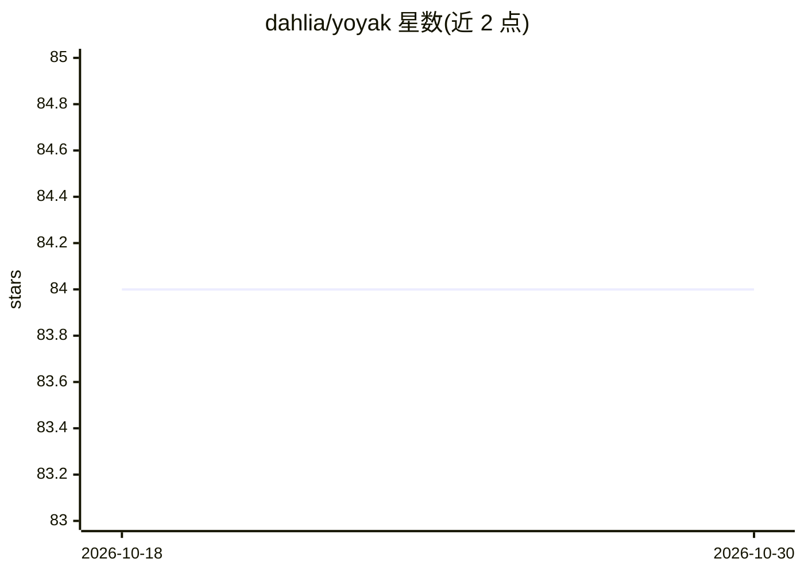

# dahlia/yoyak

⭐ 84 · TypeScript · GPL-3.0 · 推送 2026-03-23 · [GitHub](https://github.com/dahlia/yoyak) · [官网](https://jsr.io/@hongminhee/yoyak) · 个人维护

**给终端用户的 LLM 网页摘要与翻译 CLI 工具**

Yoyak 是一个使用 LLM 对网页进行摘要与翻译的命令行工具：用户通过 set-model 命令选择模型并经标准输入录入 API key，随后用 yoyak summary 命令抓取网页并输出摘要，可用 -l 选项将摘要翻译为指定语言（ISO 639-1 代码）。也支持读取本地文件路径或标准输入。提供 Linux/macOS/Windows 官方可执行文件，或通过已安装的 Deno 以 jsr 包安装。附带 bash/fish/zsh 的 shell 补全脚本，模型列表可通过 yoyak models 查询。

## 筛选速览

| 维度 | 判定 | 备注 |
|---|---|---|
| AI 角色 | `ai-native` | 本体是模型或模型工具 |
| 许可风险 | `viral` | GPL-3.0 |
| 部署形态 | `desktop` | 安装包/桌面程序 |
| 模型依赖 | — | README 未给出锁定关系 |
| 硬件要求 | — | 无带数字的原话,不猜 |
| 安装摩擦 | `low` | 无编译、无系统依赖或容器化 |
| 成熟度 | — | 结构信号不足 |

## 能力要点

- yoyak summary 命令对网页生成摘要并输出到标准输出
- -l/--language 选项将摘要翻译为指定语言
- 支持本地文件路径与标准输入作为输入源
- 提供 bash/fish/zsh shell 补全脚本

## 适用场景

- 在终端快速获取网页内容的摘要
- 把网页摘要翻译成指定语言阅读
- 在脚本管道中用标准输入处理文本摘要

## 场景标签

`AI 写作` · 领域:内容生成

## 证据(README 行号)

> L1: Yoyak: An LLM-powered CLI tool for summarizing web pages
> L5: This is a small CLI tool that uses LLM to summarize and translate web pages.
> L39: Then you can use the `yoyak summary` command to summarize a web page:

## 星数曲线

2026-10-18 84 → 2026-10-30 84（+0）

---
*卡片 v1 · prompt 1.4 · 生成 2026-10-24 · 置信度 high · 依据 README sha `f1e64a8febae` · [字段定义](../../DATASET.md)*
