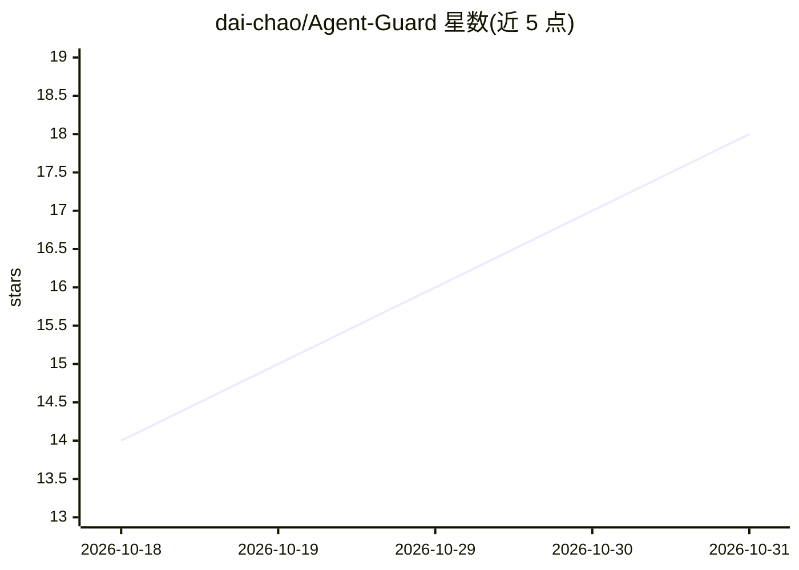

# dai-chao/Agent-Guard

⭐ 18 · 推送 2026-08-25 · [GitHub](https://github.com/dai-chao/Agent-Guard) · [官网](https://www.safeclaude.net/#) · 个人维护 · 中文 README

**本机 AI Agent 环境合规扫描与修复桌面应用，降低账号封禁风险**

面向 macOS / Windows 的桌面应用：扫描本机 AI Agent（Claude Code、Cursor、Codex、Gemini、Windsurf 等）运行环境的 20+ 风险信号，包括代理残留、时区与 IP 地理不一致、MCP 明文密钥、非官方 API 端点等，输出红/黄/绿合规灯与评分。免费版提供扫描与手动修复指引，Pro 提供一键自动修复（修复前备份到 ~/.agent-guard/backups/）。所有扫描在本机完成，数据不上云。附加可选的运行时 Hook 守护（高危操作弹窗审批、红线命令拒绝）。不提供绕过风控的能力，Linux 暂不支持。

## 筛选速览

| 维度 | 判定 | 备注 |
|---|---|---|
| AI 角色 | `ai-ecosystem` | LLM/agent 周边工具 |
| 许可风险 | `none` | — |
| 部署形态 | `desktop` | 安装包/桌面程序 |
| 模型依赖 | — | README 未给出锁定关系 |
| 硬件要求 | — | 无带数字的原话,不猜 |
| 安装摩擦 | `low` | 无编译、无系统依赖或容器化 |
| 成熟度 | — | 结构信号不足 |

## 能力要点

- 20+ 环境风险信号检测（代理、时区、MCP 密钥、API 端点等）
- 覆盖 Cursor / Claude Code / Codex / Gemini / Windsurf 等主流 Agent 的分层扫描
- Pro 一键修复，修复前自动备份可回滚
- 数据不上云，扫描与修复均在本机完成

## 适用场景

- 使用多个 AI Agent 时检查本机配置是否触发平台风控
- 清理 .zshrc 等处的代理残留与明文 API Key
- 为 Cursor / Claude Code 等接入运行时 Hook 守护高危操作

## 场景标签

`网络安全` · 领域:学习与行业

## 证据(README 行号)

> L6: **Agent Guard** 在本机一键扫描 AI Agent 环境：代理泄漏、时区指纹、配置残留、MCP 明文密钥……发现问题可修。数据不上云。
> L66: - 市面主流 Agent 合规画像（持续扩充；封号热点检测项持续加码）
> L129: - 读取本机时区、系统代理、Shell / 工具链配置、已安装 Agent 的配置文件

## 星数曲线

2026-10-18 14 → 2026-10-31 18（+4）

---
*卡片 v1 · prompt 1.4 · 生成 2026-10-30 · 置信度 high · 依据 README sha `b87f2f1fa260` · [字段定义](../../DATASET.md)*
