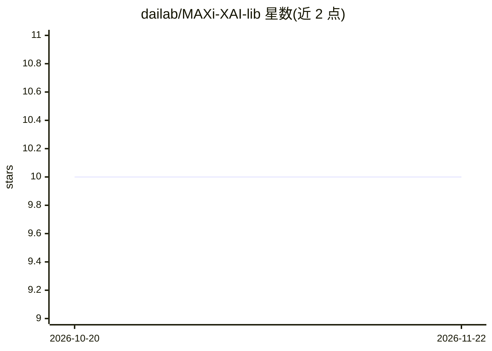

# dailab/MAXi-XAI-lib

⭐ 10 · Jupyter Notebook · MIT · 推送 2026-11-21 · [GitHub](https://github.com/dailab/MAXi-XAI-lib) · 组织维护

**面向开发者的模型无关机器学习预测解释生成库**

一个高模块化、模型无关的解释生成框架，将解释形式化为优化问题：由 Loss（解释模型）、Inference（预处理/量化外部模型预测）、Computation（优化器与梯度计算）三个组件包经 Explanation Generator 串联工作。已实现 CEM、LIME 两种解释方法，以及 Adaptive Exponentiated Gradient 等优化器和 TensorFlow 梯度计算；各组件通过继承基类扩展。需 Poetry 与 Python 3.8，支持 pip/poetry 安装或源码修改，附多套教程与 API 文档。

## 筛选速览

| 维度 | 判定 | 备注 |
|---|---|---|
| AI 角色 | `ai-native` | 本体是模型或模型工具 |
| 许可风险 | `permissive` | MIT |
| 部署形态 | `library` | 以包/库形式分发 |
| 模型依赖 | — | README 未给出锁定关系 |
| 硬件要求 | — | 无带数字的原话,不猜 |
| 安装摩擦 | `low` | 无编译、无系统依赖或容器化 |
| 成熟度 | — | 结构信号不足 |

## 能力要点

- 实现 CEM 与 LIME 两种模型无关解释方法
- Loss/Inference/Computation 三组件基类化架构，支持自定义扩展
- 解释生成形式化为优化问题，含优化器与梯度计算模块
- 提供 CEM on MNIST 等教程与组件实现指南

## 适用场景

- 为图像分类模型的预测结果生成对比性解释
- 在已有分类流程上接入 LIME/CEM 解释
- 为研究目的实现自定义解释方法的优化器或梯度计算组件

## 场景标签

 · 领域:机器学习/可解释性

## 证据(README 行号)

> L3: This repository contains a highly-modular, model-agnostic framework for explanation generation. Moreover, you will f
> L7: **Currently implemented explanation methods**:
> L86: - Modules in this subpackage implement target function of the optimization, as we formulate the explanation as an o

## 星数曲线

2026-10-20 10 → 2026-11-22 10（+0）

---
*卡片 v1 · prompt 1.4 · 生成 2026-11-20 · 置信度 high · 依据 README sha `6c3b6759995f` · [字段定义](../../DATASET.md)*
