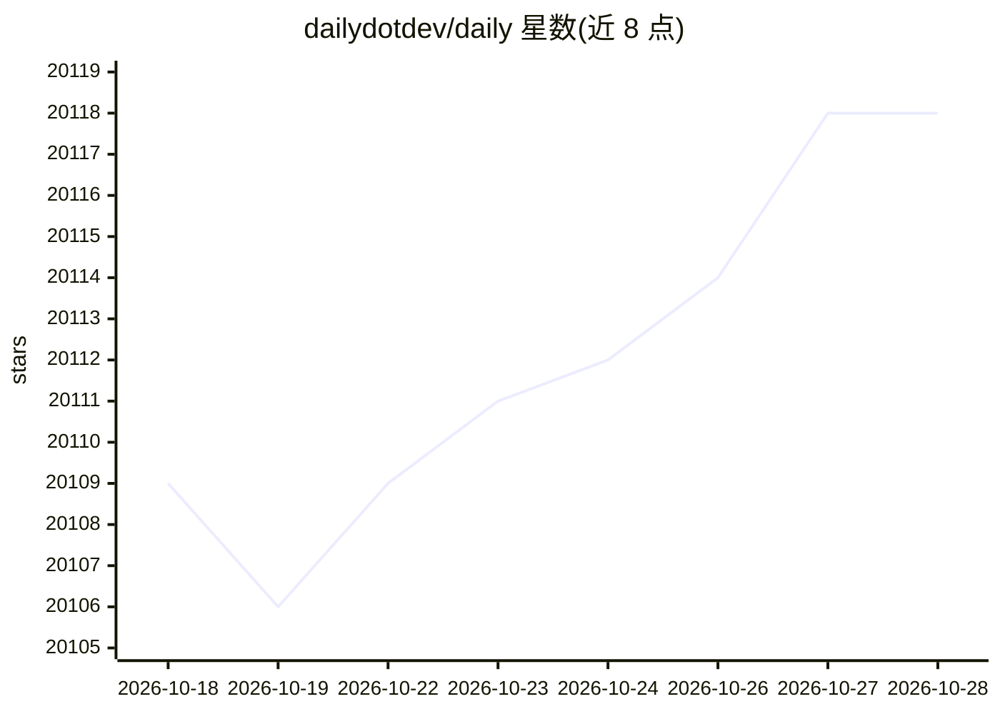

# dailydotdev/daily

⭐ 20,122 · JavaScript · AGPL-3.0 · 推送 2026-10-23 · [GitHub](https://github.com/dailydotdev/daily) · [官网](https://daily.dev) · 组织维护

**开发者的个性化新闻聚合 feed 与社区：浏览器新标签页/移动端获取技术内容**

daily.dev 是面向开发者的个性化新闻聚合服务：聚合 2,000+ 来源的文章、教程、发布说明与新闻，按用户关注的标签及阅读行为生成个性化 feed。产品形态包括 Chrome/Edge 新标签页扩展、Web 应用与 iOS/Android 移动应用，核心功能免费，另提供付费订阅 daily.dev Plus；商业模式为广告支持。代码按 AGPL-3.0 开源，前端应用位于 dailydotdev/apps 仓库，本仓库为项目中心枢纽与文档所在。每个账号可创建公共 API 的个人访问令牌，同一 API 亦提供 MCP server 供 agent 客户端接入。

## 筛选速览

| 维度 | 判定 | 备注 |
|---|---|---|
| AI 角色 | `ai-ecosystem` | LLM/agent 周边工具 |
| 许可风险 | `viral` | AGPL-3.0 |
| 部署形态 | `None` |  |
| 模型依赖 | — | README 未给出锁定关系 |
| 硬件要求 | — | 无带数字的原话,不猜 |
| 安装摩擦 | `low` | 无编译、无系统依赖或容器化 |
| 成熟度 | — | 结构信号不足 |

## 动量与使用信号

- 维护:`active` — 距上次 push 2.7 天,年发版 0,27 位贡献者
- 涨星:近 1 天 **-1**(自 20261016 起算)
- 安装:github 包 `release-assets` 月下载无数据
- 平台:ANDROID / IOS / WEB · 协议:MCP

## 能力要点

- 聚合 2,000+ 来源的内容并按标签与阅读行为个性化 feed
- Chrome/Edge 新标签页扩展、Web 应用与 iOS/Android 应用多种形态
- 公共 API 提供个人访问令牌，并以 MCP server 形式供 agent 接入
- Squads 社区、评论、书签与全站搜索功能

## 适用场景

- 在浏览器新标签页按自己关注的标签浏览技术资讯
- 通过公共 API 或 MCP 在自己的工具或 AI agent 中读取 feed、搜索与书签
- 在 Squads 社区中与开发者分享讨论内容

## 场景标签

 · 领域:开发者工具/内容聚合与社区

## 证据(README 行号)

> L35: daily.dev is a free, open source personalized news feed for developers, used by millions of developers worldwide. I
> L107: Yes. Every account can create a free personal access token for the daily.dev public API: your feed, search, bookma
> L95: Yes. daily.dev is open source under the AGPL-3.0 license. This repository is the central hub, and the frontend appl

## 星数曲线

2026-10-18 20,109 → 2026-10-28 20,118（+9）

---
*卡片 v1 · prompt 1.4 · 生成 2026-10-18 · 置信度 high · 依据 README sha `ea2d22c1b1a6` · [字段定义](../../DATASET.md)*
