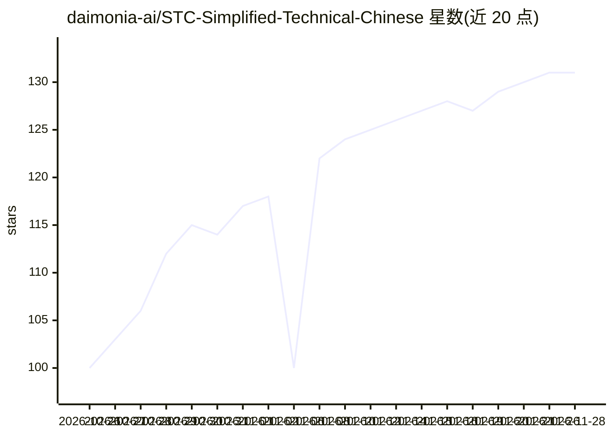

# daimonia-ai/STC-Simplified-Technical-Chinese

⭐ 131 · JavaScript · CC-BY-4.0 · 推送 2026-11-18 · [GitHub](https://github.com/daimonia-ai/STC-Simplified-Technical-Chinese) · [官网](https://daimonia.ai/open-source/stc/?utm_source=github&utm_medium=repository&utm_campaign=stc) · 组织维护 · 中文 README

**给 AI 的中文写作规范：规则、词表与检查工具**

STC 提供面向 AI 的中文写作规则、词表与机器检查工具，覆盖对话回复、文档、界面文案与 agent 指令四个场景。接入方式包括 CLI（stc init/check/update）、可安装到 Claude Code、Codex、Hermes 等的 skill 包，以及网页聊天链接。stc check 可返回退出码接入 CI；词表按 AI 输出词频排定。附 60 题评测报告，并声明受测配置中尚未证明稳定优于简短提示。

## 筛选速览

| 维度 | 判定 | 备注 |
|---|---|---|
| AI 角色 | `ai-ecosystem` | LLM/agent 周边工具 |
| 许可风险 | `viral` | CC-BY-4.0 |
| 部署形态 | `library` | 以包/库形式分发 |
| 模型依赖 | — | README 未给出锁定关系 |
| 硬件要求 | — | 无带数字的原话,不猜 |
| 安装摩擦 | `low` | 无编译、无系统依赖或容器化 |
| 成熟度 | — | 结构信号不足 |

## 能力要点

- 四个场景规则：for chat/document/web dev/instruction writing
- stc check 机器检查，退出码可接入 CI
- CLI、独立 skill 包、网页链接三种接入方式
- 任务回执按“做完了/需要你/知会”三段组织

## 适用场景

- 给 AI 产品团队统一系统提示词和 agent 输出的中文写法
- 审阅和改写已有的中文技术文档
- 检查按钮、提示、报错等界面文案
- 让 agent 完成任务后按固定格式汇报结果

## 场景标签

`提示工程` `AI 写作` · 领域:Agent 开发

## 证据(README 行号)

> L7: **STC 是给 AI 用的开源中文写作规范。** STC 提供表达规则、词表和检查工具，供 AI 生成、审阅和改写中文。可以通过命令行工具（CLI）、独立 skill（Agent 技能）或网页链接接入。
> L34: 在 Claude Code、Codex、Hermes 等能安装工具的 Agent 中，发送下面这段话：
> L278: |命令行工具|`stc init` 把 STC 装进项目，`stc check` 找出机器能判断的问题，`stc update` 更新到最新版本|`tools/`|

## 星数曲线

2026-10-26 100 → 2026-11-28 131（+31）

---
*卡片 v1 · prompt 1.4 · 生成 2026-11-28 · 置信度 high · 依据 README sha `b6f00fe7dfa1` · [字段定义](../../DATASET.md)*
