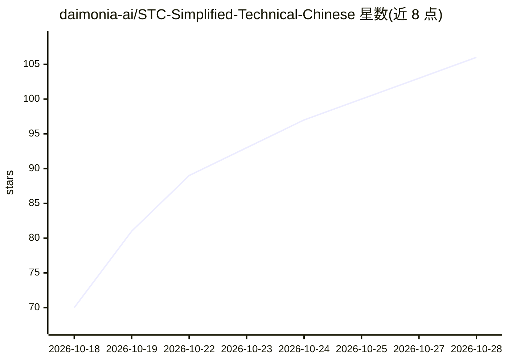

# daimonia-ai/STC-Simplified-Technical-Chinese

⭐ 112 · JavaScript · CC-BY-4.0 · 推送 2026-10-20 · [GitHub](https://github.com/daimonia-ai/STC-Simplified-Technical-Chinese) · [官网](https://daimonia.ai/open-source/stc/?utm_source=github&utm_medium=repository&utm_campaign=stc) · 组织维护 · 中文 README

**给 AI 用的开源中文写作规范：规则、词表与检查工具**

STC 提供中文表达规则（通用规则加对话、文档、产品界面、Agent 指令四类场景规则）、推荐词与不推荐写法词表及项目术语表模板，供 AI 生成、审阅和改写中文。接入方式有三种：npm 安装的 CLI（stc init / stc check）、独立 Agent skill（npx skills 安装）、网页聊天读取链接。检查命令列出可自动识别的问题、改法和规则编号，可接入 CI；事实出处和上下文含义需 Agent 或人工复核。CLI 需 Node.js 18+，规则与词表以 CC BY 4.0 授权。参考 ASD-STE100 结构但独立编写。

## 筛选速览

| 维度 | 判定 | 备注 |
|---|---|---|
| AI 角色 | `ai-knowledge` | 知识聚合/清单类 |
| 许可风险 | `viral` | CC-BY-4.0 |
| 部署形态 | `library` | 以包/库形式分发 |
| 模型依赖 | — | README 未给出锁定关系 |
| 硬件要求 | — | 无带数字的原话,不猜 |
| 安装摩擦 | `low` | 无编译、无系统依赖或容器化 |
| 成熟度 | — | 结构信号不足 |

## 能力要点

- 通用规则 + 四类场景（对话/文档/界面/Agent 指令）规则体系
- 词表含推荐词、不推荐写法与项目术语表模板
- stc check 机器检查列出问题、改法与规则编号，可接入 CI
- 三种接入方式：CLI、独立 skill、网页聊天

## 适用场景

- 让 Agent 的中文回复更简短、术语一致
- 按规范审阅并改写已有中文文档
- 团队建立可用机器检查的中文写作标准
- 统一产品界面文案（按钮、提示、报错）的写法

## 场景标签

`AI 写作` · 领域:内容生成

## 证据(README 行号)

> L7: **STC 是给 AI 用的开源中文写作规范。** STC 提供表达规则、词表和检查工具，供 AI 生成、审阅和改写中文。
> L275: |组成|内容|位置|

## 星数曲线

2026-10-18 70 → 2026-10-28 106（+36）

---
*卡片 v1 · prompt 1.4 · 生成 2026-10-23 · 置信度 high · 依据 README sha `2ed4546ba255` · [字段定义](../../DATASET.md)*
