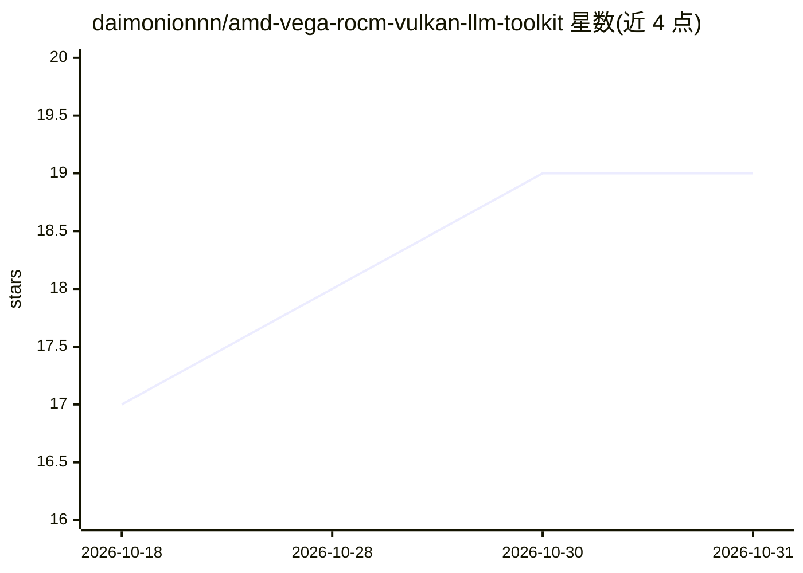

# daimonionnn/amd-vega-rocm-vulkan-llm-toolkit

⭐ 19 · Shell · MIT · 推送 2026-09-15 · [GitHub](https://github.com/daimonionnn/amd-vega-rocm-vulkan-llm-toolkit) · 个人维护

**在 AMD Vega 核显上运行本地 LLM 的脚本与基准工具集**

面向 AMD Vega 8/10 APU 与 GPU（Ryzen 5700G 等）的 Linux 工具集：提供 ROCm gfx900 backport 构建、Vulkan/RADV 启动脚本、Docker 镜像与主机引导脚本，用于运行 llama.cpp llama-server 与 LM Studio；并附带 ROCm/Vulkan/CPU 三后端的多模型基准与热监控、带速度统计的 Chat UI。文档记录了 16 GB BIOS carve-out + 64 GB UMA/GTT 内存配置、gemma 与 Qwen MoE 的对比基准，以及 Vulkan 32K 上下文死锁等限制。基于作者单机（5700G）实测维护。

## 筛选速览

| 维度 | 判定 | 备注 |
|---|---|---|
| AI 角色 | `ai-ecosystem` | LLM/agent 周边工具 |
| 许可风险 | `permissive` | MIT |
| 部署形态 | `desktop` | 安装包/桌面程序 |
| 模型依赖 | local-ok | 支持本地模型 |
| 硬件要求 | — | 无带数字的原话,不猜 |
| 安装摩擦 | `low` | 无编译、无系统依赖或容器化 |
| 成熟度 | — | 结构信号不足 |

## 能力要点

- Vulkan（RADV）默认启动器自动检测 Vega 8 设备，另有 --cpu/--rocm/--rocm-docker 模式
- ROCm 7.2 gfx900 tensile backport 的 Docker 镜像与裸机构建脚本
- 多后端×多模型基准运行器，输出 CSV 汇总
- 一键 bootstrap 脚本恢复 GRUB GTT 参数、用户组与 ROCm 安装

## 适用场景

- 在 Vega 核显机器上跑通本地 llama.cpp 服务并选 ROCm/Vulkan 后端
- 对比 APU 上不同后端与上下文长度的推理速度
- 系统重装后快速恢复 LLM 运行环境

## 场景标签

`推理引擎` · 领域:训练与推理

## 证据(README 行号)

> L3: Toolkit for ROCm and Vulkan LLM inference on Vega APUs/GPUs (tested on AMD Ryzen 5700G APU) + tools for multi-GPU LL
> L127: |`run/start-llama-server.sh`|**Main launcher.** Vulkan by default (auto-detects the Vega 8 Vulkan device). `--cpu`

## 星数曲线

2026-10-18 17 → 2026-10-31 19（+2）

---
*卡片 v1 · prompt 1.4 · 生成 2026-10-29 · 置信度 high · 依据 README sha `16996c4348fc` · [字段定义](../../DATASET.md)*
