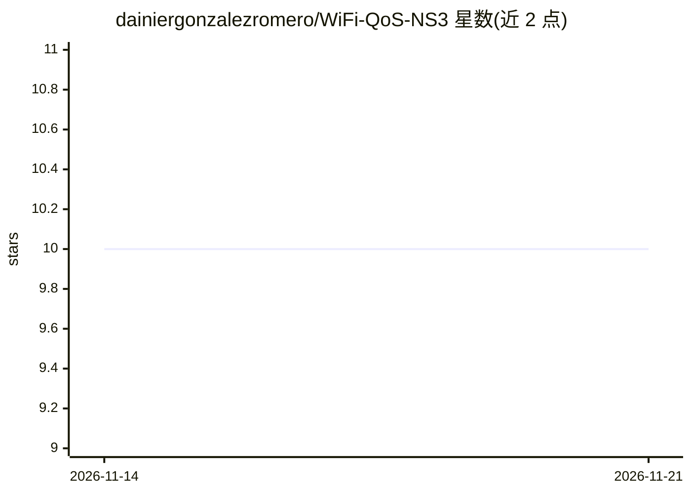

# dainiergonzalezromero/WiFi-QoS-NS3

⭐ 10 · Python · MIT · 推送 2026-10-08 · [GitHub](https://github.com/dainiergonzalezromero/WiFi-QoS-NS3) · 个人维护

**面向科研的 NS-3 WiFi QoS 仿真与 AI 参数优化框架**

基于 NS-3 的开源仿真框架，结合 SDN、IEEE 802.11e EDCA QoS 与机器学习构建知识定义无线网络（KDWN）。扩展 WiFi 模块实现认知接入点 PoFiAp 与 SDN 控制器 KDNController 的 PacketIn/FlowMod 交互；Python 智能体用随机森林（500 棵树、24 目标输出）预测吞吐/时延/丢包，并以 Optuna 贝叶斯优化求解最优竞争窗口。附仿真数据生成、统计聚合、验证与出版级绘图的自动化脚本链，面向研究 WiFi QoS 优化的科研人员。

## 筛选速览

| 维度 | 判定 | 备注 |
|---|---|---|
| AI 角色 | `ai-native` | 本体是模型或模型工具 |
| 许可风险 | `permissive` | MIT |
| 部署形态 | `library` | 以包/库形式分发 |
| 模型依赖 | — | README 未给出锁定关系 |
| 硬件要求 | — | 无带数字的原话,不猜 |
| 安装摩擦 | `medium` | 含编译或系统依赖之一 |
| 成熟度 | — | 结构信号不足 |

## 能力要点

- 随机森林多输出回归同时预测 24 个网络指标
- Optuna 贝叶斯优化（TPE）自动搜索 CWmin/CWmax
- PoFiAp 与 KDNController 的 SDN 参数下发与事件驱动更新机制
- 1000+ 配置大规模并行仿真与 95% 置信区间绘图

## 适用场景

- 在 NS-3 中仿真不同节点密度下的 EDCA QoS 表现
- 自动寻找使时延和丢包最小的竞争窗口参数
- 生成论文用的多配置性能对比图（36 张 PDF）

## 场景标签

`科研工具` · 领域:学习与行业

## 证据(README 行号)

> L3: CA-SDWN-WiFi-QoS is an open-source NS-3 simulation framework for Software-Defined Wireless Networks, IEEE 802.11e ED
> L61: 3. **Multi-output Modeling**: Trains a **Random Forest Regressor** (500 estimators) to predict 24 targets simultane
> L19: * Optimize network parameters (CWmin/CWmax) automatically using **Bayesian Optimization (`TPE`)** with **Optuna**

## 星数曲线

2026-11-14 10 → 2026-11-21 10（+0）

---
*卡片 v1 · prompt 1.4 · 生成 2026-11-19 · 置信度 high · 依据 README sha `2074378ed424` · [字段定义](../../DATASET.md)*
