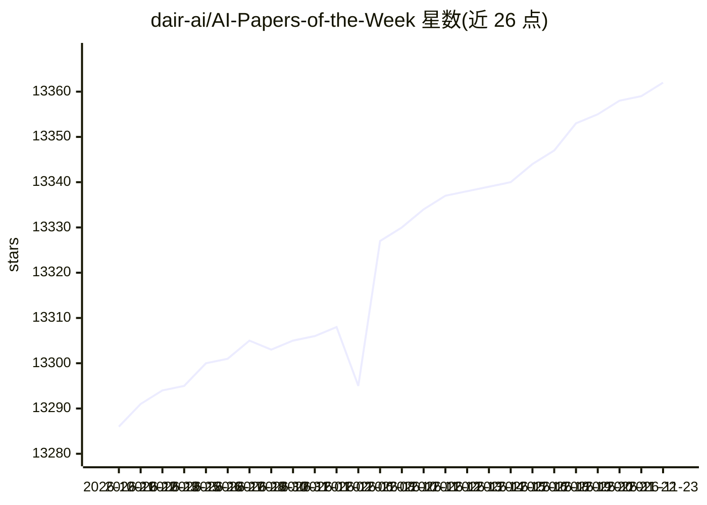

# dair-ai/AI-Papers-of-the-Week

⭐ 13,362 · 推送 2026-11-16 · [GitHub](https://github.com/dair-ai/AI-Papers-of-the-Week) · 组织维护

**每周精选 AI 论文的清单仓库，附邮件订阅**

DAIR.AI 维护的论文聚合仓库，按周归档 2023 年至今的 AI 顶会/研究论文清单，每周一期以链接列表形式发布。仓库本身不包含工具或代码，主要功能是浏览历史各期内容，并引导读者通过 newsletter 邮件订阅、Twitter 与 Discord 获取每周更新。读者可直接在 GitHub 查看往期归档，或订阅后每周在邮箱收到精选论文列表。

## 筛选速览

| 维度 | 判定 | 备注 |
|---|---|---|
| AI 角色 | `ai-knowledge` | 知识聚合/清单类 |
| 许可风险 | `none` | — |
| 部署形态 | `None` |  |
| 模型依赖 | — | README 未给出锁定关系 |
| 硬件要求 | — | 无带数字的原话,不猜 |
| 安装摩擦 | `low` | 无编译、无系统依赖或容器化 |
| 成熟度 | — | 结构信号不足 |

## 动量与使用信号

- 维护:`active` — 距上次 push 5.7 天,年发版 0,9 位贡献者
- 涨星:近 1 天 **+2**(自 20261016 起算)
- 安装:github 包 `release-assets` 月下载无数据

## 能力要点

- 按周归档 2023 年至今的 AI 论文精选清单
- 支持邮件 newsletter 订阅每周推送
- 提供 Twitter 与 Discord 社区渠道

## 适用场景

- 每周跟踪 AI/ML 领域新发表的论文
- 检索某个时间段发布过的相关论文
- 通过邮件订阅获取每周论文摘要

## 场景标签

`精选清单` · 领域:学习与行业

## 证据(README 行号)

> L3: Subscribe to our newsletter to get a weekly list of top AI papers in your inbox.
> L5: At DAIR.AI we ❤️ reading AI papers so we've created this repo to highlight the top AI papers of every week.
> L7: Here is the weekly series:

## 星数曲线

2026-10-21 13,286 → 2026-11-23 13,362（+76）

---
*卡片 v1 · prompt 1.4 · 生成 2026-11-22 · 置信度 high · 依据 README sha `dd0f086f6897` · [字段定义](../../DATASET.md)*
